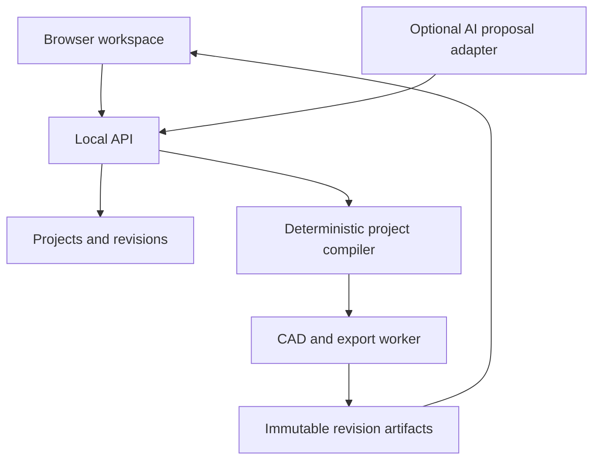

# Woodworking Platform Full Codex Plan

Prepared 2026-10-13. This is the consolidated readable implementation plan. The accompanying ZIP contains the same documents plus the machine-readable schemas, nine project inputs, and exact expected results. Keep the ZIP folder available to Codex for implementation.

## Contents

1. [Handoff instructions](#1-handoff-instructions)
2. [Product and architecture](#2-product-and-architecture)
3. [Data and geometry](#3-data-and-geometry)
4. [CAD integration](#4-cad-integration)
5. [API and jobs](#5-api-and-jobs)
6. [Construction and exports](#6-construction-and-exports)
7. [Implementation sequence](#7-implementation-sequence)
8. [Acceptance tests](#8-acceptance-tests)
9. [Sources and evidence](#9-sources-and-evidence)
10. [Example guide](#10-example-guide)
11. [Handoff validation](#11-handoff-validation)

## 1. Handoff instructions


Prepared 2026-10-13. Handoff version 1.0.

### What you are building

Build a local woodworking design application that turns a supported furniture idea and measured material dimensions into an editable 3D model, a reliable cut list, and a measured project packet. Begin with one plywood bookcase template. Add natural-language editing after the deterministic design engine works.

This package contains the implementation specification, data contract, worked examples, and acceptance criteria. It contains no completed application and no structurally approved furniture design.

### How to use this package

1. Extract the ZIP into a folder that Codex can read.
2. Open the intended application workspace in Codex. Use a new empty repository unless you already have a project you want to extend.
3. Put this handoff inside that workspace as a documentation folder, or give Codex its absolute path.
4. Paste the implementation prompt below. Keep the supporting JSON files accessible; they contain exact expected results.
5. Let Codex complete the milestones in order. A milestone is complete when its acceptance gate passes, not when its UI appears finished.

Do not replace an existing repository's AGENTS.md with this package. Codex should read the existing instructions and reconcile them with the explicit project request.

### Implementation prompt to paste into Codex

> Implement the woodworking design application specified in this handoff. Read START-HERE.md, WOODWORKING-PLATFORM-PLAN.md, docs/IMPLEMENTATION-SEQUENCE.md, docs/DATA-AND-GEOMETRY.md, docs/CAD-INTEGRATION.md, docs/API-AND-JOBS.md, docs/CONSTRUCTION-AND-EXPORTS.md, docs/ACCEPTANCE-TESTS.md, the JSON schemas, and the example fixtures before editing.
>
> Inspect the current workspace, repository status, AGENTS.md files, existing conventions, and available runtimes. Preserve unrelated work. If this is an empty workspace, create a separate application repository named woodworking-platform. Use text-to-cad through a pinned adapter; do not turn its entire monorepo into our application or substitute a mock 3D scene for CAD integration.
>
> Use the selected architecture: React with TypeScript and Vite for the browser UI; Three.js through React Three Fiber for the viewer; Python 3.13, FastAPI, Pydantic, SQLite, and local artifact storage for the backend; a separate, app-controlled process for trusted CAD jobs using cadgen 0.7.21. The baseline upstream commit is 24573128ceaab564f497d7c12f995c41784c9539. Verify the pinned contract during the integration spike, record the dependency lockfiles, and document any necessary deviation with evidence.
>
> Implement M0 and M1 first: the reproducible CAD spike, canonical specification and unit parsing, deterministic bookcase part compiler, stable instance identities, exact fixture arithmetic, genuine CAD outputs, CSV cut list, and immutable artifact manifest. Prove that the baseline and mutation examples agree across the model and exported data. Then continue through the next milestones in docs/IMPLEMENTATION-SEQUENCE.md while their dependencies are satisfied.
>
> The first supported project is an open-front plywood bookcase with full-height sides, top and bottom between the sides, zero to four fixed shelves, and an applied back. Outside depth includes the back. Actual measured material thickness is authoritative. Every model, part list, cut list, drawing, and export must describe one immutable revision.
>
> Build the forms and deterministic engine before the AI layer. The application must remain useful without an API key. AI may propose allowlisted parameter changes through structured data; it may not execute generated Python, shell commands, or filesystem paths.
>
> Keep finished panel dimensions, rough blank allowances, and saw kerf separate. Keep manufacturing part identity separate from mesh identity and cut-list grouping. Do not infer structural capacity, complete joinery instructions, or hardware sizes from geometry. Implement the construction-recipe contract and the explicit draft/completeness states described in the handoff.
>
> Work autonomously on routine local implementation, dependency setup, reversible fixes, and meaningful verification. Maintain docs/IMPLEMENTATION-STATUS.md with completed milestone gates, exact run commands, measured results, and remaining dependencies so work can continue across sessions. Do not stop after writing another plan or after building an attractive mockup.
>
> Do not deploy, publish, buy services, enter credentials that have not been supplied, push code externally, or change operating-system security settings. If a missing credential, unsupported runtime, or physical construction review blocks one feature, finish independent local work and report the exact blocked gate. Do not mark a skipped check as passed.
>
> At each substantial checkpoint, report what works, how to run it, what was verified, and the next milestone. At completion, provide the local launch instructions, sample project, passing acceptance evidence, export package, and any explicitly incomplete physical-review or optional-provider capability.

### Reading order

| File | Purpose |
|---|---|
| [WOODWORKING-PLATFORM-PLAN.md](#2-product-and-architecture) | Product scope, chosen architecture, behavior, priorities, and release definition |
| [docs/IMPLEMENTATION-SEQUENCE.md](#7-implementation-sequence) | Ordered engineering tasks, exit gates, and checkpoint prompts |
| [docs/DATA-AND-GEOMETRY.md](#3-data-and-geometry) | Units, identities, exact bookcase rules, manufacturing data, and fixture arithmetic |
| [docs/CAD-INTEGRATION.md](#4-cad-integration) | The supported upstream boundary, GLB identity and coordinate conversion, runtime isolation |
| [docs/API-AND-JOBS.md](#5-api-and-jobs) | HTTP contract, persistence, revisions, jobs, recovery, AI proposals |
| [docs/CONSTRUCTION-AND-EXPORTS.md](#6-construction-and-exports) | Construction recipes, drawings, cut lists, materials, stock planning, project exports |
| [docs/ACCEPTANCE-TESTS.md](#8-acceptance-tests) | Observable checks and a final demonstration script |
| [docs/SOURCES.md](#9-sources-and-evidence) | Primary sources and the boundary between verified upstream facts and proposed app requirements |
| spec/project.schema.json (packaged as spec/project.schema.json in the ZIP) | Version 1 canonical project contract |
| spec/ai-proposal.schema.json (packaged as spec/ai-proposal.schema.json in the ZIP) | Restricted AI proposal response contract |
| spec/artifact-manifest.schema.json (packaged as spec/artifact-manifest.schema.json in the ZIP) | Published artifact identity, versions, hashes, and completeness contract |
| [examples/README.md](#10-example-guide) | Meaning of each fixture and expected-results file |
| [docs/HANDOFF-VALIDATION.md](#11-handoff-validation) | Checks performed on this handoff and the application checks still to run |

### Settled defaults

The first release is a single-user local web application for a Windows computer. It needs no 3D printer, CNC machine, cloud account, or paid hosting to use its form-based design workflow. The default display is inches with metric equivalents; canonical dimensions are decimal millimeters. The reference template is a 30 in wide, 12 in deep, 36 in high bookcase made from measured 18 mm panels and a measured 6 mm applied back.

The neutral working title is “Woodworking Planner.” Branding, accounts, subscriptions, a template marketplace, and public deployment are later decisions. Do not invent those requirements during the first build.

### What the examples prove

The example numbers are a software correctness contract for panel geometry, quantities, units, and stock-layout logic. They do not establish a safe shelf load or certify a fastening method. The supplied example's construction recipe is intentionally unselected, so it must produce a clearly identified design packet until a complete recipe is supplied and checked.

The handoff distinguishes three deliverable levels:

- **Design engine complete:** reproducible geometry, parts, cut list, and dimensioned design packet.
- **Local application complete:** editing, persistence, jobs, viewer, exports, and optional AI proposal handling work through the documented acceptance checks.
- **Construction template reviewed:** an authored recipe supplies every attachment operation, compatible hardware, and build sequence, with a recorded physical review where required before public release.

Do not collapse these into one “ready to build” badge.

## 2. Product and architecture


**Prepared:** 2026-10-13  
**Audience:** Codex implementing the application and the project owner reviewing its behavior  
**Handoff version:** 1.0  
**Working product name:** Woodworking Planner

### 1. The outcome

Create a woodworking design application in which a person describes a supported furniture project, supplies real dimensions and material thicknesses, reviews a 3D model, and downloads a consistent set of project documents.

The defining capability is reliable change propagation. If a person changes the bookcase width or plywood thickness, the application must update the affected boards, clear openings, 3D assembly, cut list, material quantities, and drawings from the same source. A convincing rendering with contradictory cut dimensions does not meet the product goal.

Begin with a deliberately narrow family: an open-front plywood bookcase with full-height sides, a top and bottom between the sides, zero to four fixed shelves, and a full applied back. Complete that family before adding cabinets with doors, drawers, benches, tables, or workbenches.

The product is software for planning woodworking projects. A person can build the resulting project with appropriate woodworking tools; a 3D printer is not a prerequisite.

### 2. Assumptions and decisions

These are implementation decisions for this handoff, not claims about features already present in text-to-cad.

| Decision | Selected default | Reason |
|---|---|---|
| First user | One person on a Windows computer | Delivers a useful personal tool without an account or hosting project |
| Delivery | Browser UI served by a local Python application | Fits the user's computer while keeping CAD in a suitable runtime |
| Project storage | SQLite plus an application data directory | Simple local persistence with explicit repository interfaces for later migration |
| CAD integration | Pinned cadgen dependency behind our adapter | Reuses the upstream CAD work without coupling every module to it |
| First furniture family | Parametric plywood bookcase | Small enough to verify completely; demonstrates most panel-based workflows |
| Input priority | Structured dimension and material forms | Establishes a reliable core that remains usable without AI |
| Natural language | Optional structured proposal layer | Adds convenience after the same parameters already work through forms |
| Canonical unit | Millimeters represented as normalized decimal strings | Avoids hidden binary rounding and preserves user-entered fractions |
| Initial display | Inches, with metric equivalents in measured outputs | Fits a US workflow while retaining exact material dimensions |
| Initial joinery geometry | Butt-contact panels, no grooves or rabbets | Gives exact, inspectable size rules |
| Construction instructions | Versioned, authored recipe | Fasteners and assembly order require real construction decisions |
| Initial export | CSV, project JSON, STEP, per-part GLB, measured PDF, ZIP | Covers review, building preparation, and future editing |
| CNC | Later DXF profile export only | Toolpaths need a separate machine-specific CAM workflow |
| Hosting, accounts, billing | Deferred | They do not prove that a board has the right dimensions |

Do not ask the project owner to choose among stacks unless the selected stack conflicts with an existing project or a verified runtime constraint. Document routine implementation choices and proceed.

### 3. The first complete user experience

#### Create a project

The home screen offers “New bookcase” and a list of saved projects. A small dimension illustration labels outside width, outside height, and outside depth including the applied back. The user selects inches or millimeters and enters dimensions.

The material section separately records the main panel material and back material. A preset may fill a nominal label, but the measured thickness remains explicit and editable. The reference data uses 18 mm main panels and a 6 mm back; a label such as “3/4 in plywood” must never silently change 18 mm to 19.05 mm.

The user selects zero to four fixed shelves. Version 1 uses equal clear openings. The interface immediately explains the derived carcass depth, inside width, number of openings, and number of panels. Final arithmetic is validated by the backend.

#### Generate and inspect

“Generate design” creates an immutable project revision and starts a CAD job. While the job runs, the screen shows its actual stage, such as validating parameters, generating geometry, checking dimensions, or preparing outputs.

The viewer supports orbit, pan, zoom, fit, front/side/top/isometric views, select, isolate, hide, and restore. Selecting a board highlights its corresponding instance and cut-list entry. Selecting a cut-list row highlights its member instances. An exploded view is a presentation transform; it never changes stored assembly geometry or exported cut dimensions.

Beside the viewer, show the design dimensions, materials, parts, cut list, construction method, and documents. A successful model does not automatically mark an incomplete construction recipe complete.

#### Edit and regenerate

Changing a field makes the current form a draft. Show a compact change summary before applying: for example, “Inside panels become 878.4 mm long; the back becomes 914.4 mm wide.” Applying the change produces a new immutable revision. Keep the previous successful revision available while the new build runs.

Do not silently show an old model under new dimensions. The interface must distinguish “draft inputs,” “building revision,” and “last successful revision.” Downloads always identify their revision.

#### Export and reopen

The user can download a project ZIP that contains its canonical specification, resolved parts, CSV cut list, materials and hardware records, drawings, supported geometry files, and artifact manifest. Every file belongs to one revision and has a checksum in the manifest.

The user can close the browser and backend, restart the application, and reopen the same project. The last successful revision remains usable even if an interrupted newer job needs to be retried.

### 4. What the upstream repo contributes

The research baseline is text-to-cad release **v0.7.21**, commit **24573128ceaab564f497d7c12f995c41784c9539**. Recheck compatibility during milestone M0 and keep the initial implementation pinned. The upstream “latest” branch is a plugin distribution branch; it is not the complete development source tree. Use the pinned source when inspecting internals. [Sources U1–U3](#9-sources-and-evidence)

| Upstream capability | How this app uses it | Work owned by this application |
|---|---|---|
| Python/build123d geometry and STEP generation | Generate exact panel solids and an assembly | Furniture templates, dimensions, joinery rules, part definitions |
| GLB export | Tessellate unique parts for the browser | Stable instance identity, assembly manifest, selection, scene state |
| Engineering drawing library | Derive measured part views into PDF | Project packet layout, US Letter support, cut-list pages, instructions |
| DXF generation | Later export flat panel profiles | Part profile policy, grain, stock planning, CAM handoff labels |
| Geometry inspection utilities | Check measured dimensions and solid validity | Template-specific tolerances, contact rules, completeness decisions |
| Agent skills and local viewer | Help Codex develop and inspect the adapter | The woodworking product's own UI, storage, job orchestration |

The upstream engineering drawing workflow supports projected, measured PDF views; its documented limits include no section, detail, or auxiliary views. It does not provide a ready-made woodworking instruction system. [U4](#9-sources-and-evidence)

The normal static GLB export can merge geometry by color. This app must not assume that a board will survive as a uniquely named GLB node. Version 1 therefore uses per-unique-part GLBs plus application-owned instance transforms and IDs. [U6](#9-sources-and-evidence)

### 5. Architecture

#### Selected stack

Use React, TypeScript, and Vite for the UI. Use Three.js through React Three Fiber for the model viewer. Use FastAPI and Pydantic in Python 3.13 for the API and domain layer. Use SQLite for local records, with short transactions and one local job dispatcher. Use filesystem artifacts in immutable revision directories.

The CAD runner is a separate operating-system process using the pinned cadgen environment. Long CAD work must not run inside a request handler or be treated as an ordinary FastAPI background callback. The API returns a job ID promptly; the browser polls job status. A broker and distributed queue are unnecessary for the first local release. The process boundary also makes failure recovery and later worker replacement clearer. [T1](#9-sources-and-evidence)

For PDFs, use an application-owned report renderer for the multi-page project packet and a separate cadgen engineering-drawing adapter for supported measured part drawings. ReportLab is the selected packet renderer. Confirm the installed public drawing API during M0 rather than inventing a drawing command. If native part sheets remain A4, the application must identify their paper size; it must not relabel or scale them into purported 1:1 Letter templates.

Use standard pytest for domain and worker checks and Playwright for a small set of meaningful browser flows. Use the frontend's normal type checking and build. Pin compatible dependency versions in lockfiles after the integration spike; only cadgen/Python are preselected here.

#### Component boundaries

The domain compiler accepts a validated ProjectSpec and returns a ResolvedProject. It has no browser, network, database, or CAD dependency. It calculates parts, quantities, placements, openings, material needs, and construction requirements.

The CAD adapter accepts that resolved project and produces geometry artifacts plus measured verification results. It must not independently reinterpret furniture dimensions.

The export layer receives the resolved project, measured geometry where needed, construction-recipe output, and revision metadata. It never asks AI to invent missing cut dimensions.

The API owns project persistence, immutable revisions, job requests, artifact retrieval, and proposal application. The browser consumes these contracts. The AI adapter can propose validated input changes and explanations; it cannot bypass the domain compiler.



#### Application repository

Create a separate application repository. Use these logical boundaries; adapt directory names to a justified existing convention without changing responsibilities.

| Path | Responsibility |
|---|---|
| apps/web | React UI, viewer, typed API client, browser tests |
| services/api/src/woodwork/api | HTTP routes and response contracts |
| services/api/src/woodwork/domain | Models, unit parsing, validation, part ledger, revision hashing |
| services/api/src/woodwork/templates | Versioned trusted furniture templates |
| services/api/src/woodwork/cad_adapter | All direct cadgen/build123d use |
| services/api/src/woodwork/jobs | Dispatcher, process lifecycle, cancellation, recovery |
| services/api/src/woodwork/exports | CSV, PDF, stock layouts, project bundles |
| services/api/src/woodwork/recipes | Versioned construction and hardware recipes |
| services/api/src/woodwork/ai | Provider interface, structured proposals, fake provider |
| services/api/src/woodwork/storage | SQLite repositories, migrations, artifact storage |
| packages/contracts | Generated JSON Schema, OpenAPI client types, shared format fixtures |
| tests/fixtures | Supplied reference projects and expected results |
| scripts | Documented setup, development, preflight, and smoke-test commands |
| docs | Architecture decisions, source provenance, launch guide, implementation status |

Do not import a cadgen private module outside the adapter. Prefer public exports; if an internal interface is unavoidable, pin it, explain it, and add a focused adapter compatibility test.

### 6. Canonical data and units

The supplied JSON Schema is the initial contract. The Python domain models become the maintained implementation source of truth; generated JSON Schema and TypeScript types must remain compatible with it. Do not manually maintain unrelated versions of the same project model in multiple languages.

Store canonical dimensions as normalized decimal millimeter strings, such as “762”, “304.8”, or “18”. Inputs may be decimal millimeters, centimeters, inches, or mixed inch fractions with an explicit unit. Accept denominators 1, 2, 4, 8, 16, 32, and 64. Use the exact international conversion 1 in = 25.4 mm. [T3](#9-sources-and-evidence)

Use Decimal/Fraction arithmetic through normalization and the deterministic compiler. Derived repeating positions are resolved once to 0.000001 mm, using round-half-even, when the final ledger is materialized. Convert to floating point only at the geometry/viewer boundary. Display rounding is independent; a rounded inch label never feeds back into the saved design.

Version 1 has separate input, resolved, and artifact records:

- **ProjectSpec:** user intent, template version, dimensions, actual materials, manufacturing settings, construction selection, output preferences.
- **ResolvedProject:** deterministic dimensions, exact/exposed openings, part definitions, physical instances, placements, cut groups, construction requirements, validation results.
- **Revision and ArtifactManifest:** immutable identifiers, source hashes, toolchain versions, job evidence, artifact records, checksums, and completeness state.

Every physical board has a stable logical ID. A side remains “side_left” after a width change. A new or removed shelf is explicitly added or removed. A separate manufacturing fingerprint groups interchangeable cut parts; it must include machining, material, grain, and edge treatment rather than dimensions alone.

For details and matrices, use [DATA-AND-GEOMETRY.md](#3-data-and-geometry). The supplied examples are the authoritative arithmetic baseline.

### 7. Reference bookcase

The reference dimensions are **762 mm wide × 304.8 mm deep × 914.4 mm high**, equivalent to 30 × 12 × 36 inches. The finished outside depth includes the applied back. Main panels are actually 18 mm thick; the back is actually 6 mm thick. There are two fixed shelves, equal clear openings, no edge banding, and no joinery deductions.

| Part category | Quantity | Face-local finished dimensions L × W × T |
|---|---:|---|
| Full-height side | 2 | 914.4 × 298.8 × 18 mm |
| Top, bottom, fixed shelves | 4 | 726 × 298.8 × 18 mm |
| Applied back | 1 | 914.4 × 762 × 6 mm |

The interior width is 726 mm, the carcass depth is 298.8 mm, and each of the three clear openings is 280.8 mm high. The assembly contains seven physical panels. The geometry-only cut list can group them into three rows; adding machining may split groups.

The reference intentionally has no selected fastening recipe. It is a design-engine fixture. A complete build packet requires the recipe contract in section 11.

Required mutations include:

- Width 914.4 mm: inside panels become 878.4 mm long; outside height and panel depth remain fixed.
- Main thickness 19 mm: inside panels become 724 mm long; clear openings become exactly 4192/15 mm before final position quantization.
- Outside depth 355.6 mm: carcass depth becomes 349.6 mm; the back's face dimensions remain tied to height and width.
- Zero shelves: five physical panels, with one 878.4 mm clear opening in the baseline 18 mm material.

These examples test dimensional propagation. They do not establish a furniture load rating.

### 8. Validation behavior

Validation should answer specific questions at the appropriate boundary.

**Input validation** rejects malformed values, unsupported options, duplicate IDs, absent material references, nonpositive dimensions, or impossible openings. Show the affected field, the reason, and a useful correction. Do not silently clamp a design into a different shape.

**Domain validation** checks the template formulas, part counts, material thicknesses, positive blank dimensions, recipe applicability, grain policies, and reference consistency.

**Geometry validation** checks that exported parts exist, are valid solids, have the expected dimensions and placements, and have no unexpected material overlap. The panel template defines permitted face contacts. Contact is not a collision; an inspection failure is not a pass.

**Export validation** checks revision binding, measured dimension agreement, cut-list quantities, readable PDFs, correct units, and file hashes.

**Construction completeness** checks whether the selected recipe supplies the needed operations, compatible hardware, and assembly sequence. Structural capacity remains unassigned unless a separate substantiated method is actually implemented and reviewed.

Keep those results separate. Prefer labels such as “Dimensions checked” and “Construction method needed” to a broad “Safe” or “Certified” label.

### 9. CAD runtime and jobs

Pin cadgen 0.7.21. Upstream examples use managed Python 3.13. Keep runtime setup in an explicit preflight command that reports versions and tests loading the CAD kernel. First-run native/runtime/browser dependencies must be installed before the offline design smoke test. [U1–U3](#9-sources-and-evidence)

Version 1 runs only application-owned template code. Job input is immutable JSON data. Reject uploaded Python, evaluated formulas, shell commands, and caller-selected module paths. A subprocess is a lifecycle boundary, not an untrusted-code sandbox.

Disable the upstream warm daemon for the initial worker with CADGEN_DAEMON=0. The app controls one CAD job at a time, an explicit wall-clock deadline, and process-tree cleanup. Give workers app-specific state/cache directories and disable app-worker telemetry without changing the user's separate CAD configuration. [U7](#9-sources-and-evidence)

Start with a 120-second CAD job deadline and a 120-second export deadline as adjustable engineering budgets. Log cold/warm timing and peak memory during M0 and M6, then adjust documented budgets using evidence. Do not promise those numbers as achieved performance.

After cancellation or failure, no partial artifact becomes a successful current revision. Use temporary output directories, checksum and validate, publish an immutable artifact set, and then update database pointers transactionally. On restart, expired running jobs become interrupted and can be retried explicitly.

The Windows preflight must diagnose native OCP loading failures. If the documented Windows security/runtime issue applies, offer the supported WSL execution path. Do not automate disabling Windows security. Native Windows and WSL are separate environments; keep each environment's Python, Node, files, and process management coherent. [U1](#9-sources-and-evidence)

### 10. Cut lists, material planning, and costs

Derive cut lists from the resolved manufacturing ledger. A row records part or group ID, member instances, material, quantity, finished L/W/T, rough L/W/T where applicable, grain orientation, machining, and edge treatment.

The finished panel dimension is the target board size for the current no-banding/no-rebate template. A rough allowance enlarges a stock blank and is shown separately. Saw kerf is removed by a cut and consumes sheet/board layout space; it is never added to the finished dimensions of every part.

The core release can provide accurate cut lists before it provides a packing algorithm. Add the conservative rectangular stock planner in M4 after the basic documents work. Use actual sheet dimensions, explicit edge trim, measured kerf, material/thickness matching, grain restrictions, and a valid guillotine cut sequence. Describe it as a suggested layout; do not claim optimality.

Area divided by sheet area is only a lower-bound estimate. It cannot establish how many sheets the parts actually fit on. Do not turn that lower bound into a confident shopping quantity.

Material cost estimates use user-entered prices first. Show purchased quantities and consumed material separately. Missing prices remain unknown and make the estimate incomplete; do not treat them as zero. Use decimal money arithmetic, a visible currency, and clearly identified assumptions for waste, consumables, shipping, and tax. Automated retailer prices are deferred.

### 11. Construction method and build instructions

A woodworking platform must explain how boards connect. CAD face contact does not identify a fastener, hole position, jig setting, adhesive requirement, or assembly sequence.

Implement a versioned ConstructionRecipe interface. A supported recipe declares its compatible material and thickness conditions, joint locations, fastener types and quantities, drilling/machining operations, tool requirements, dependency order, and applicable review evidence.

The first implementation should support the baseline butt-contact geometry and a complete authored attachment recipe. A pocket-hole recipe is a reasonable first supported option if its particular jig and actual-thickness rules are sourced from the manufacturer. Kreg's guidance makes actual material thickness and material type relevant to screw selection; it does not justify inventing settings for every possible stock thickness. [W1–W2](#9-sources-and-evidence)

Keep the geometry fixture recipe-free. Supply a separate reviewed recipe fixture once the method is implemented. Do not fill missing fastener values with plausible defaults merely to make a shopping list look complete.

The recipe must account for attaching each side/top/bottom/shelf interface and the applied back. A dependency graph determines the order in which parts are machined and assembled. The user-facing instructions identify the affected part IDs and show their orientation. Exploded images support the text; they are not proof that a tool can reach a fastener.

If a recipe is missing or incompatible, allow the model and clearly identified design packet. Mark the missing method beside the relevant instruction/material output. A separate complete build packet is available only when its recipe completeness checks pass.

Before describing a template as physically reviewed for broader public use, record a real build review or other appropriate evidence. Codex can complete the software and produce the review checklist and sample packet; it cannot claim to have performed a physical build that did not occur.

### 12. PDF and project exports

The project packet should include:

1. Cover with project title, revision, outside dimensions, materials, scope, and a 3D overview.
2. Dimensioned assembly views that explain outside dimensions and internal openings.
3. Numbered part list and cut list with consistent IDs and units.
4. Part drawings showing the dimensions and machining actually specified.
5. Material and hardware quantities, with unknown items identified.
6. Authored assembly steps when a complete recipe is selected, otherwise a precise missing-recipe note.
7. Suggested stock layouts only when the layout validator has passed.
8. A compact revision and verification record.

Use Letter as the default for application-owned project pages. Provide A4 as an option. Keep native cadgen ISO part sheets identified by their actual size until the adapter has genuine additional paper support. Readable line weights, text size, whitespace, and nonoverlapping dimension callouts are acceptance requirements.

All PDF values come from the resolved project or measured geometry. Hand-entered dimension strings are prohibited in generated templates. Render and inspect every page for the acceptance examples; the existence of a PDF file is insufficient.

The pinned native drawing code's units string changes the title-block label without converting dimensions. Native part sheets therefore remain explicitly metric in this release; the app's own schedules and summary pages perform real dual-unit conversion. A 25.4 mm feature must read as 1 inch wherever an imperial value is shown. [U9](#9-sources-and-evidence)

The ZIP manifest includes each payload file's relative path, MIME type, size, SHA-256, revision ID, and spec hash. It excludes its own checksum and the enclosing ZIP's checksum to avoid a circular definition; those outer hashes belong in the database/export response. Never include API keys, machine-specific absolute paths, raw private prompts, or temp worker files.

Retain whole-assembly STEP and one STEP plus one GLB per unique part definition. The GLBs and manifest provide the interactive scene; a required identity sidecar maps instances to saved assembly occurrences and its file hash. Document jobs publish cumulative artifact sets so adding PDFs never drops the geometry files. STL/3MF are not required for the first woodworking release. Later DXFs are millimeter, 1:1 panel profiles with clearly separated cutting and marking geometry, without router G-code. The repo's G-code workflow is for FDM slicing, so it is not the router toolpath solution. [U5, U8](#9-sources-and-evidence)

### 13. Natural-language assistance

Add AI after the validated form workflow and document export work.

Example prompt: “Make a bookcase 30 inches wide, 36 inches high, and 12 inches deep with two fixed shelves. My plywood measures 18 mm and the back is 6 mm.”

The AI adapter returns a structured proposal containing a supported intent, an allowlisted template, proposed field changes, unresolved questions, and a short explanation. It references the base revision. The backend validates its schema and semantics, computes the resulting dimensions, and presents a before/after summary.

The app applies a proposal only through its normal revision-creation service. If the project has changed since the proposal was generated, return a conflict and refresh the proposal. AI text never directly updates the database, part ledger, or files.

Version 1 AI edits may change overall width/height/depth and fixed-shelf count, or ask for missing information. Actual stock thickness is entered through the measured-material form; AI may ask for it but may not silently override a measured value. Requests for unsupported furniture, doors, drawers, organic shapes, or joints produce a specific scope explanation.

Use a provider-neutral interface with a deterministic fake provider. The optional first live adapter can use the user's configured provider, with its model identifier and credentials on the backend only. Codex must consult that provider's current official API documentation during implementation, choose a supported structured-output mechanism, and record the pinned SDK and API behavior. No particular live model or pricing is assumed in this handoff.

Use a configurable request timeout, input and output limits, one schema-repair attempt at most, and no automatic repeat of a request with uncertain billing outcome. The offline form-based workflow must continue to work with AI disabled or unavailable.

### 14. Interface design

The workspace should feel like a useful woodworking tool: a large neutral model viewport, clearly labeled dimensions, a readable parts table, and a small number of strong actions. Use a restrained warm-neutral palette with clear selected-part color. Avoid a marketing landing page as the main application.

On a desktop screen, use a left parameter panel, center viewport, and right details panel that can collapse. Put parts/documents/materials in tabs below or beside the viewport. On narrower screens, stack the parameter and detail panels; keep tables scrollable without losing headings.

Support keyboard navigation, visible focus, labeled form inputs, text alternatives for validation status, and selection that is not communicated by color alone. A person should be able to enter parameters and download a cut list without operating the 3D viewport.

Essential screen states include no projects, initial runtime setup, editing, validation error, queued job, active job, cancellation, failed job, successful revision, changed draft, missing construction method, missing optional AI configuration, and offline AI failure. Design those states as part of the product.

### 15. Local data and operating behavior

Bind the API to loopback only. Serve the built UI from the same application origin for ordinary use; use a narrowly allowed development origin while Vite runs separately. Check Host and Origin, protect state-changing local requests against cross-origin use, and never allow a caller to select an arbitrary filesystem path.

Place application data outside the code checkout under an explicit configurable data root. SQLite records metadata; artifact paths are server-generated relative paths underneath that root. Do not place a live SQLite file in a cloud-synced folder by default. Provide project ZIP export/import for portable backups.

Keep imports inert: validate JSON, size limits, schema versions, file hashes, relative paths, and ZIP entry paths; do not execute model source received in a project package. Rebuild supported projects from the canonical specification with installed trusted templates.

Keep optional API keys on the backend in environment/local settings excluded from git. Logs should contain useful stage/error codes, runtime versions, and timings without keys or full private prompts. Application-worker telemetry is off by default.

A later hosted version adds authenticated ownership, tenant isolation, remote object storage, a proper durable queue, rate limits, usage accounting, backup/restore, and restricted worker execution. Those are separate release requirements. Opening a local port to the internet is not the hosted architecture.

### 16. Implementation sequence and definition of done

Follow [IMPLEMENTATION-SEQUENCE.md](#7-implementation-sequence). The major gates are:

| Milestone | Result that must be demonstrable |
|---|---|
| M0 — Integration spike | Pinned runtime builds a trusted part and exports it with verified units, orientation, and identity strategy |
| M1 — Deterministic engine | Baseline and mutation fixtures yield correct parts, solids, CSV, and manifest without AI or browser |
| M2 — Local application | Create, edit, inspect, select, save, reopen, cancel, and recover a real project |
| M3 — Measured documents | PDF packet and construction-recipe contract work; incomplete and complete recipe cases are distinguished |
| M4 — Stock and costing | Conservative verified layouts and transparent material estimates use real quantities and explicit prices |
| M5 — AI proposals | Structured natural-language edits use the same validated engine and handle missing data/conflicts |
| M6 — Local release | Setup, failure recovery, meaningful tests, sample projects, documentation, and export/import are complete |

M0–M3 are the first useful product. M4–M6 complete the planned local version. Additional furniture families and public hosting remain later work.

An acceptance test is complete only when it ran and its result is recorded. The supplied acceptance document describes tests for Codex to implement; this handoff does not claim those application tests have already run.

### 17. Performance and cost discipline

Collect timing evidence during the first CAD spike, then use it to set realistic user-facing expectations. Provisional targets are sub-second pure parameter compilation, responsive status polling during CAD work, a usable viewer for the reference seven-panel project, and bounded background job duration. These are design budgets, not measured claims.

Do not add paid infrastructure to get through M0–M3. The form workflow needs no inference service. Optional AI usage has provider costs determined by the chosen model, tokens, images, and request volume; add usage visibility when a live adapter exists. Hosting and retailer-price integrations are future budget decisions.

Do not quote a fixed completion date based on this plan alone. After M0 and M1, report the actual integration difficulties, elapsed engineering work, and remaining milestone scope. That is the point at which a useful schedule estimate can be made.

### 18. Later product roadmap

Add one capability at a time, with new fixtures and construction rules.

1. **More panel furniture:** a wall-free storage cabinet, console, or media cabinet, each with explicit supported constraints.
2. **Adjustable shelves:** shelf-pin system, hole patterns, setbacks, hardware, and drilling templates.
3. **Doors and drawers:** reveal/inset/overlay rules, specific hinge and slide models, interference and opening checks.
4. **More joinery:** dados, rabbets, dowels, edge banding, and tool-aware recipes with changed cut-size semantics.
5. **Solid wood:** actual board sizes, grain and movement allowances, rough milling, and material-specific joints.
6. **Reference images:** style and proportions with user-supplied dimensional anchors; never infer hidden measurements as facts.
7. **CNC preparation:** verified DXF profiles and a separately specified CAM integration.
8. **Hosted platform:** accounts, saved cloud projects, sharing, templates, billing, and operational support after local trust is established.

Do not label a renamed bookcase template as a storage bench or load-bearing work platform without supplying the new construction assumptions and review. Those uses change the design problem.

### 19. Acceptance demonstration

The final local demonstration must show a new project generated from the reference fixture; seven selectable panels and correct cut groups; readable measured drawings; a width change to 36 inches; a material change to 19 mm; a zero-shelf project; a rejected impossible design; a cancelled job; recovery after restart; and a consistent exported ZIP that can be reopened.

Demonstrate a missing recipe producing a design packet and a complete supported recipe producing its corresponding instructions. Demonstrate the fake AI provider and, if configured, the live provider. Show that the app remains usable with AI disabled.

Report concrete evidence and remaining limitations. A successful software demonstration does not stand in for a physical construction review.

### 20. Source and decision boundaries

Primary source links, pinned upstream files, and the exact scope of each source are in [SOURCES.md](#9-sources-and-evidence). Source-backed facts describe available tools and documented formats. The architecture, template equations, product limits, schema, milestones, and acceptance gates are the proposed engineering specification.

If runtime behavior contradicts a source or this handoff, reproduce the difference with the smallest example, record it in an architecture decision, update the adapter and affected fixture deliberately, and rerun the relevant checks. Do not silently weaken dimensional consistency or completeness requirements to make a milestone pass.

## 3. Data and geometry


### 1. Fixed cabinet template

This fixture defines an open-front cabinet with full-height sides, top and bottom between the sides, zero to four equally spaced fixed shelves, and a full-cover applied back. Every part is rectangular. It models butt interfaces without fasteners, machining, edge banding, doors, or drawers. **No hardware specification or load rating is implied.** Dimensions, material labels, stock, and kerf below are declared fixture inputs.

CAD coordinates are right-handed: X runs left to right, Y front to back, and Z bottom to top. The outside bounding box starts at the origin. **Outside depth includes the applied back.**

| Canonical ProjectSpec field | Symbol | Baseline |
|---|---|---:|
| `dimensions.outside_width_mm` | $W$ | `762` = 30 in |
| `dimensions.outside_height_mm` | $H$ | `914.4` = 36 in |
| `dimensions.outside_depth_mm` | $D$ | `304.8` = 12 in |
| `dimensions.fixed_shelf_count` | $n$ | `2` |
| `materials.main.actual_thickness_mm` | $t$ | `18` |
| `materials.back.actual_thickness_mm` | $b$ | `6` |
| `manufacturing.saw_kerf_mm` | $k$ | `3.2` |
| `manufacturing.rough_allowance_per_edge_mm` | $a$ | `0` |
| `manufacturing.sheet_edge_trim_mm` | $e$ | `10` |
| `manufacturing.stock_sheets` | — | Separate 2440 × 1220 × 18 mm and 2440 × 1220 × 6 mm stock |

Main and back nominal labels may be `3/4 in` and `1/4 in`; they are metadata. Their conversions, 19.05 and 6.35 mm, never replace the actual 18 and 6 mm inputs. The stock dimensions are also actual numeric inputs, independent of any nominal sheet label. Each stock entry references `material_id` and inherits that material's actual thickness; the stock schema has no independent thickness or quantity field. The baseline entries `main_sheet` and `back_sheet` reference `plywood_main` and `plywood_back`, respectively.

### 2. Normalization and formulas

Canonical millimeter values are normalized decimal strings with at most six fractional digits. Parse user measurements and convert units exactly. **Reject raw input whose exact converted millimeter value requires more than six fractional digits** after insignificant trailing zeros are removed; normalization does not round an input to make it acceptable. Use Fraction/Decimal arithmetic internally. **HALF_EVEN at 0.000001 mm applies only to derived positions and values**, once at the final resolved-ledger/kernel boundary. Presentation rounding must never feed back into fabrication values.

Let carcass depth be $C$, inside width $I$, and target clear opening height $g$:

$$
C=D-b,\qquad I=W-2t,\qquad
g=\frac{H-(n+2)t}{n+1}.
$$

For shelf slot $j=1,\ldots,n$:

$$
z_{\text{shelf bottom},j}=j(g+t),\qquad
z_{\text{shelf center},j}=j(g+t)+\frac{t}{2}.
$$

The bottom occupies Z $[0,t]$; the top occupies $[H-t,H]$. Opening $q=0,\ldots,n$ occupies:

$$
X=[t,W-t],\quad Y=[0,C],\quad
Z=[t+q(g+t),(q+1)(g+t)].
$$

Baseline values are **C = 298.8 mm, I = 726 mm, g = 280.8 mm**. The clear opening is measured between faces; shelf-center spacing is $g+t$.

### 3. Definitions, instances, and manufacturing dimensions

A manufactured definition describes one reusable part shape. An instance places that shape in the assembly. Semantic IDs persist across dimensional revisions; a separate content hash changes with manufacturing attributes.

| Definition ID | Finished local L × W × T, mm | Quantity | Instance IDs |
|---|---|---:|---|
| `panel_side` | 914.4 × 298.8 × 18 | 2 | `side_left`, `side_right` |
| `panel_horizontal` | 726 × 298.8 × 18 | 4 | `bottom`, `shelf_01`, `shelf_02`, `top` |
| `panel_back` | 914.4 × 762 × 6 | 1 | `back` |

Baseline: **three definitions, seven instances, six main-thickness pieces, one back**. Generally, horizontal quantity is $n+2$, main-piece count $n+4$, and total count $n+5$.

Shelf IDs are fixed template slots `shelf_01` through `shelf_04`. Count reductions remove the highest slots; increases restore them. Surviving IDs persist even when equal spacing moves their positions. Count editing does not support arbitrary middle-shelf deletion.

Each local box is centered on its origin:

$$
[-L/2,L/2]\times[-W_{\!local}/2,W_{\!local}/2]\times[-T/2,T/2].
$$

Local L is the specified face axis, **not necessarily the longest dimension**. In this baseline, materials use `face_grain: along_L` and stock uses `grain_axis: length`, so grain is locked; nesting allows 0° or 180°, not 90°. Installed grain runs vertically on sides/back and across the cabinet width on horizontal panels. The schema also permits `none`; that is a distinct grain setting, not the baseline fixture's policy.

Rough face dimensions are $L_r=L+2a$, $W_r=W_{local}+2a$; thickness stays actual stock thickness. Assembly geometry uses finished dimensions; nesting uses rough rectangles. Baseline rough equals finished. At $a=1$ mm, rough faces become 916.4 × 300.8, 728 × 300.8, and 916.4 × 764 mm. **Kerf is not added to either finished or rough part dimensions.**

Definition grouping must include material, actual thickness, dimensions, grain, allowances, and any future edge/machining attributes. Equal bounding boxes alone will not establish equivalence once drilling or joinery exists.

### 4. Proper rotations and center placement

Matrices below are written as rows and multiply column vectors:

$$
p_{world}=R p_{local}+c.
$$

$$
R_h=\begin{bmatrix}1&0&0\\0&1&0\\0&0&1\end{bmatrix},\quad
R_s=\begin{bmatrix}0&0&-1\\0&1&0\\1&0&0\end{bmatrix},\quad
R_b=\begin{bmatrix}0&1&0\\0&0&1\\1&0&0\end{bmatrix}.
$$

Each satisfies $R^TR=I_3$ and $\det R=+1$. Side local axes map to $(+Z,+Y,-X)$; back axes map to $(+Z,+X,+Y)$. Replacing the side thickness direction with +X while keeping the other axes produces a reflection. Both side instances deliberately use the same proper rotation; local +T is not labeled an outward face.

| Instance | Rotation | General center | Baseline center, mm |
|---|---|---|---|
| `side_left` | $R_s$ | $(t/2,C/2,H/2)$ | (9, 149.4, 457.2) |
| `side_right` | $R_s$ | $(W-t/2,C/2,H/2)$ | (753, 149.4, 457.2) |
| `bottom` | $R_h$ | $(W/2,C/2,t/2)$ | (381, 149.4, 9) |
| `shelf_01` | $R_h$ | $(W/2,C/2,g+3t/2)$ | (381, 149.4, 307.8) |
| `shelf_02` | $R_h$ | $(W/2,C/2,2g+5t/2)$ | (381, 149.4, 606.6) |
| `top` | $R_h$ | $(W/2,C/2,H-t/2)$ | (381, 149.4, 905.4) |
| `back` | $R_b$ | $(W/2,D-b/2,H/2)$ | (381, 301.8, 457.2) |

Sides occupy X [0,18] and [744,762]; horizontal panels occupy X [18,744]. Main parts occupy Y [0,298.8]; the back occupies Y [298.8,304.8]. Overall AABB is exactly **(0,0,0) to (762,304.8,914.4) mm**. Butt faces may touch; interiors do not overlap.

#### Per-definition GLB conversion

Export each unique definition at its local origin; use the instance manifest for assembly. For CAD millimeters to glTF meters:

$$
A=\begin{bmatrix}1&0&0\\0&0&1\\0&-1&0\end{bmatrix},\qquad
p_g=0.001A p_{cad}.
$$

If this conversion is baked into each local GLB, manifest transforms must be:

$$
R_g=A R A^{-1},\qquad c_g=0.001A c.
$$

In particular:

$$
R_{s,g}=\begin{bmatrix}0&-1&0\\1&0&0\\0&0&1\end{bmatrix},\qquad
R_{b,g}=\begin{bmatrix}0&0&-1\\1&0&0\\0&-1&0\end{bmatrix}.
$$

Do not apply another scene-level conversion. Expected glTF centers include `side_left` (0.009, 0.4572, −0.1494), `shelf_01` (0.381, 0.3078, −0.1494), and `back` (0.381, 0.4572, −0.3018) meters. Convert units after resolving millimeters; rounding meters prematurely loses precision.

### 5. Baseline invariants and mutations

All three baseline openings have clear size **726 × 298.8 × 280.8 mm**, with Z intervals [18,298.8], [316.8,597.6], and [615.6,896.4].

| Quantity | Exact baseline result |
|---|---:|
| Main face area: $2HC+(n+2)IC$ | 1,414,160.64 mm² |
| Back face area: $WH$ | 696,772.8 mm² |
| Main volume | 25,454,891.52 mm³ |
| Back volume | 4,180,636.8 mm³ |
| Total part/assembled-union volume | 29,635,528.32 mm³ |

Each mutation below starts independently from baseline.

| Mutation | Horizontal finished L × W × T, mm | Opening target g, mm | Total volume, mm³ |
|---|---|---:|---:|
| Width = 36 in = 914.4 mm | 878.4 × 298.8 × 18 | 280.8 | 33,750,328.32 |
| Actual main thickness = 19 mm | 724 × 298.8 × 19 | $4192/15$ | 31,004,271.36 |
| Outside depth = 14 in = 355.6 mm | 726 × 349.6 × 18 | 280.8 | 33,963,200.64 |
| Shelf count = 0 | 726 × 298.8 × 18, quantity 2 | 878.4 | 21,826,091.52 |
| Actual back thickness = 9 mm | 726 × 295.8 × 18 | 280.8 | 31,470,275.52 |

**Width:** sides remain unchanged; back becomes 914.4 × 914.4 × 6 mm. Right-side X center becomes 905.4; all horizontal/back X centers become 457.2 mm. Y/Z values stay unchanged.

**Main thickness:** sides become 914.4 × 298.8 × 19 mm; back remains unchanged. Side X centers are 9.5 and 752.5. Bottom/top Z centers are 9.5 and 904.9. Exact shelf Z centers are $9239/30$ and $18193/30$ mm, resolving to **307.966667 and 606.433333**. Target g resolves to 279.466667, while gaps re-measured from resolved boxes are 279.466667 / 279.466666 / 279.466667 mm. Assert equality before quantization and use **0.000002 mm** absolute tolerance for resolved placement/contact checks. Never compute later shelf positions from an already rounded g.

**Depth:** sides become 914.4 × 349.6 × 18 mm; main Y centers become 174.8; back Y center becomes 352.6 mm. Back face size and all X/Z values stay unchanged.

**Back thickness:** main Y centers become 147.9; back becomes 914.4 × 762 × 9 mm centered at Y = 300.3. Outside depth stays 304.8 mm.

Shelf-count fixtures, with all other baseline parameters unchanged:

| n | Horizontal quantity / total instances | g, mm | Shelf center Z values, mm |
|---:|---|---:|---|
| 0 | 2 / 5 | 878.4 | None |
| 1 | 3 / 6 | 430.2 | 457.2 |
| 2 | 4 / 7 | 280.8 | 307.8, 606.6 |
| 3 | 5 / 8 | 206.1 | 233.1, 457.2, 681.3 |
| 4 | 6 / 9 | 161.28 | 188.28, 367.56, 546.84, 726.12 |

Zero shelves leaves one opening X [18,744], Y [0,298.8], Z [18,896.4]. There are no zero-size placeholder shelves. Counts 1, 3, and 4 have respective total volumes 25,730,809.92, 33,540,246.72, and 37,444,965.12 mm³.

### 6. Stock layout and executable geometric cut sequence

This is a deterministic valid candidate, without an optimal-yield claim. Sheet coordinates are Sx/Sy, with grain along Sx. Ten-millimeter trims leave **[10,2430] × [10,1210]**, a 2420 × 1200 mm rectangle. Treat main/back stock as separate material pools.

Sort rough rectangles by decreasing L, decreasing W, then lexicographic instance ID. The baseline main-sheet placements are:

| Instance | Sx, mm | Sy, mm | Rough L × W, mm |
|---|---:|---:|---|
| `side_left` | 10 | 10 | 914.4 × 298.8 |
| `side_right` | 927.6 | 10 | 914.4 × 298.8 |
| `bottom` | 10 | 312 | 726 × 298.8 |
| `shelf_01` | 739.2 | 312 | 726 × 298.8 |
| `shelf_02` | 1468.4 | 312 | 726 × 298.8 |
| `top` | 10 | 614 | 726 × 298.8 |

All rotations are 0°. Row part envelopes are 1832, 2184.4, and 726 mm long. Their combined height including two intervening kerfs is 902.8 mm. **These envelopes omit cuts needed to release the last row and the last part in each row.** Reserve the trailing bands below as well.

First trim the original sheet. For this fixture, removed trim-cut bands are X [6.8,10] and [2430,2433.2], then Y [6.8,10] and [1210,1213.2] on the remaining piece. These lie within the declared discard margins and preserve the exact usable rectangle.

Then isolate rows in order using full-width cuts through the current remainder; crosscut each isolated row using the listed bands in ascending X order:

| Step/piece | Removed kerf band(s), mm | Resulting offcut |
|---|---|---|
| Isolate row 1 | Y [308.8,312] | Pass upper remainder to next step |
| Isolate row 2 | Y [610.8,614] | Pass upper remainder to next step |
| Isolate row 3 | Y [912.8,916] | X [10,2430], Y [916,1210] |
| Crosscut row 1 | X [924.4,927.6], [1842,1845.2] | X [1845.2,2430], Y [10,308.8] |
| Crosscut row 2 | X [736,739.2], [1465.2,1468.4], [2194.4,2197.6] | X [2197.6,2430], Y [312,610.8] |
| Crosscut row 3 | X [736,739.2] | X [739.2,2430], Y [614,912.8] |

There are three row-isolation kerfs and six crosscut kerfs after trimming. The final row-release cut ends at Y = 916; the longest row-release crosscut ends at X = 2197.6, both within usable stock.

On the separately trimmed back sheet, place `back` at (10,10), face 914.4 × 762 mm. Isolate a strip with Y kerf [772,775.2], then crosscut with X kerf [924.4,927.6]. Offcuts are [10,2430] × [775.2,1210] and [927.6,2430] × [10,772].

These cut bands partition the usable sheets exactly:

| Stock | Part area | Internal kerf area | Remaining offcut area | Sum, mm² |
|---|---:|---:|---:|---:|
| Main | 1,414,160.64 | 28,968.96 | 1,460,870.4 | 2,904,000 |
| Back | 696,772.8 | 10,182.4 | 2,197,044.8 | 2,904,000 |

Each original sheet adds 72,800 mm² of reserved edge bands, giving 2,976,800 mm² total. Edge bands include trimming kerf and discard; internal kerf above excludes them. These are geometric cut allocations, not machine-specific operating instructions.

#### Synthetic exact-fit kerf test

For a 306.4 × 100 mm sheet with no trim, three 100 × 100 mm rough pieces and k = 3.2 fit at X = 0, 103.2, 206.4. Kerfs are [100,103.2] and [203.2,206.4]. The last part reaches the stock boundary:

$$
3(100)+2(3.2)=306.4.
$$

There is no trailing separation cut at an already finished stock edge. A 306.3 mm sheet fails. A 300 mm sheet also fails despite equal kerf-free area. With 5 mm trims on all edges, 316.4 × 110 mm restores the same usable region; X starts become 5, 108.2, 211.4. Adding 1 mm allowance to each L edge makes the required width $3(102)+2(3.2)=312.4$ mm.

Whenever the last part ends inside stock and an offcut remains, a release cut must be modeled outside that part. Do not infer a valid cut sequence from nonoverlapping placement rectangles alone. Any partially overhanging blade/edge-cut behavior requires explicit support; this fixture uses full kerf bands contained in the source piece.

### 7. Parser, validity, and revision regressions

Use exact conversion 1 in = 25.4 mm. Supported fractional denominators are 1, 2, 4, 8, 16, 32, 64. Examples:

| Input | Normalized millimeters |
|---|---:|
| `30 1/2 in` | `774.7` |
| `3/4 in` or `0.75 in` | `19.05` |
| `1 1/8 in` | `28.575` |
| `23 7/16 in` | `595.3125` |
| `1/64 in` | `0.396875` |

Reject malformed numbers, zero denominators, unsupported denominators, nonfinite values, excess precision, and ambiguous unitless input without a declared default. In particular, raw `1.2345678 mm`, `18.0000005 mm`, and `18.0000015 mm` are rejected. Nominal-only edits leave geometry unchanged. An explicit actual-thickness change to 19.05 mm produces horizontal length 723.9 and g = 279.4 mm.

The following are **internal derived-value rounding tests**, not accepted user measurements:

| Exact internally derived value, mm | Resolved value, mm | Rule |
|---|---:|---|
| 18.0000005 | 18 | HALF_EVEN tie to the even last digit |
| 18.0000015 | 18.000002 | HALF_EVEN tie to the even last digit |

Validate $t>0$, $b>0$, $W>2t$, $D>b$, $H>(n+2)t$, and integer $0\le n\le4$. Kerf, trim, and rough allowance must be nonnegative; usable stock must have positive dimensions. Reject features that collapse at resolved precision: n = 2, t = 18, H = 72.000001 mm gives a positive exact gap that rounds to zero.

Also apply the product support bounds in `API-AND-JOBS.md`; mathematical boundary fixtures can deliberately fall outside those bounds to exercise domain errors. Test W = 36 mm, D = 6 mm, and H = 72 mm with baseline thickness/count; each produces a zero required dimension. Shelf count −1, 1.5, or 5 fails. A stock entry must reference a declared material and inherit its thickness, without silently substituting another material. A valid cabinet whose grain-locked sides exceed usable stock remains valid geometry but reports an unplaceable part. For example, 900 × 1220 mm stock with 10 mm trims offers only 880 mm along grain, below the 914.4 mm side length.

Every artifact carries its immutable source revision and resolved-ledger hash. Start export A at baseline revision r1; change width to 36 inches at r2; let export B finish before A. Late A must not replace r2 downloads or preview. Reject a bundle combining r1's 726 mm horizontal cut list with r2's 878.4 mm assembly. Also test old failures arriving late, kerf-only changes, and restoring old dimensions under a new revision.

All outputs consume one resolved ledger. Keep definition geometry, instance identity, and transforms explicit; do not reconstruct cut sizes from world mesh bounds or merged assembly meshes. Regression coverage must check quantities, proper rotations/grain, all requested mutations, exact unit parsing, cut-band partitions, stock-material separation, invalid states, and revision coherence.

## 4. CAD integration


### 1. Responsibility and runtime pin

The CAD adapter accepts the **ResolvedProject** defined in [DATA-AND-GEOMETRY.md](#3-data-and-geometry). It produces genuine geometry, saved-artifact measurements, and export records for one immutable revision. The domain compiler owns woodworking formulas, manufacturing identity, placements, and quantities; the adapter implements that resolved design without interpreting the original request again.

Use **cadgen 0.7.21**, upstream commit **`24573128ceaab564f497d7c12f995c41784c9539`**, through its packaged Python runtime. This was the latest release verified on October 13, 2026 UTC. Keep the initial integration pinned even if a newer release appears. The upstream package is classified Beta. [Release] [Dependencies]

| Runtime component | Required treatment |
|---|---|
| Python | Use 3.13; record the tested patch version |
| cadgen | Pin `cadgen==0.7.21` |
| build123d | Resolve within upstream `>=0.11.1,<0.12`, then lock the actual version |
| Native CAD provider | Resolve `cadquery-ocp-novtk>=7.9,<8`, then lock the actual version |
| Playwright | Upstream pin is `1.63.0`; install its matching browser during setup |
| Node | Mesh export requires Node >=20; select and lock one tested release |

The released skills use managed Python 3.13. A package installation alone does not prove that the native kernel, Node exporter, browser renderer, and PDF renderer all work. M0 must exercise every required component. [Dependencies] [CAD skill] [Node runtime]

Record application, template, adapter, Python, cadgen, build123d, OCP, and Node versions in the artifact manifest. Upgrade through a reviewed dependency change and rerun the adapter acceptance corpus. Preserve the source pin and lockfiles in project documentation. Compare measured geometry across environments; do not substitute a blanket cross-platform STEP byte-equality requirement for geometric equivalence.

Use public cadgen interfaces. Keep upstream cache formats, `_internal` modules, and private viewer HTTP routes outside the application contract. The existing upstream viewer can help a developer inspect artifacts, but the product uses its own manifest-driven viewer.

### 2. Adapter pipeline

Implement the following order:

1. Receive an immutable, validated ResolvedProject and its revision/hash.
2. Revalidate its structural contract and referenced part definitions in the worker.
3. Build each unique definition in the canonical local frame.
4. Export a STEP and a GLB for each definition.
5. Place the definitions from the supplied instance transforms and export assembly STEP.
6. Reopen saved STEP files and measure dimensions, solids, labels, and placements.
7. Generate the requested drawing/export artifacts.
8. Return an artifact manifest and validation report for publication by the coordinator.

All quantities and cut groups come from the ResolvedProject. Do not infer them from triangle counts, STEP solids, material colors, or a rendered image. Upstream occurrence leaves can contain several solids; its geometry hierarchy does not infer manufactured parts. [Inspection]

Place assembly copies with `.moved(...)` or `Location * shape`, preserving a separate occurrence label for each board. Use the supplied proper rotation/translation matrices. Do not use transformations to conceal an incorrect part size or rederive placements inside the adapter. [Model contract]

### 3. Trusted JSON drivers

Cadgen generation runs a Python model script. A decorated `@step` function is **parameterless**; parameterized geometry belongs in ordinary trusted factories. `cadgen step build` re-emits an existing STEP document and is not a text/JSON model-generation command. [Model contract] [STEP API]

Ship reviewed static driver templates with the application. Copy them into the app-owned job directory and place immutable JSON inputs beside them. Keep all user text and numbers in JSON. Do not interpolate a project title, path, parameter, or AI response into Python source. Resolve inputs relative to the driver file and read them inside the model body.

Use one fixed part driver per definition directory and one fixed assembly driver. The part driver consumes already-resolved dimensions; it does not subtract panel thickness, calculate shelf spacing, or choose joinery. The assembly driver consumes the exact instance ledger. Treat driver code and factory versions as build inputs.

#### M0 illustrative spike: one centered panel

This verifies the public decorator and export route. It is **not the application worker**: production still needs the full schema, bounded dimensions, part registry, process supervision, and saved-artifact checks. Put this reviewed `part.py` beside a `part.json` containing exactly three decimal millimeter strings.

```python
from decimal import Decimal
from pathlib import Path
import json

from cadgen import build123d as bd
from cadgen import glb, step

HERE = Path(__file__).resolve().parent
KEYS = ("length_mm", "width_mm", "thickness_mm")


@step(out="out/part.step")
@glb(out="out/part.glb")
def part():
    data = json.loads((HERE / "part.json").read_text(encoding="utf-8"))
    if not isinstance(data, dict) or set(data) != set(KEYS):
        raise ValueError("Expected exactly the three panel dimensions")
    values = []
    for key in KEYS:
        if not isinstance(data[key], str):
            raise ValueError(f"{key} must be a decimal millimeter string")
        value = Decimal(data[key])
        if not value.is_finite() or value <= 0:
            raise ValueError(f"{key} must be finite and positive")
        values.append(float(value))
    shape = bd.Box(
        *values,
        align=(bd.Align.CENTER, bd.Align.CENTER, bd.Align.CENTER),
    )
    shape.label = "part"
    return shape


if __name__ == "__main__":
    part()
```

Example spike input:

```json
{"length_mm":"726","width_mm":"298.8","thickness_mm":"18"}
```

Run the file using the pinned interpreter. Decimal values become floats only at the geometry boundary. The production driver must also reject values outside the template's supported envelope before this conversion. [Model contract]

### 4. Supported public export routes

| Output | Interface |
|---|---|
| Part/assembly STEP | `@step(out=...)`; run the trusted model script |
| Maintained part GLB | Stack `@glb(out=...)` with `@step` |
| GLB from saved STEP | `cadgen.glb.build(Path(step_path), Path(glb_path), ...)` or `cadgen glb build INPUT.step OUTPUT.glb` |
| Inspection | `cadgen.read_step`, `cadgen.read_scene`, and `cadgen.geometry` |
| Measured native PDF | `from cadgen.eng_drawing import Sheet, eng_drawing`; decorated function returns a Sheet or list of sheets |
| DXF profile | Parameterless `@dxf` returning XY build123d geometry or a layer-to-geometry mapping |
| Review snapshot | `cadgen step snapshot INPUT.step OUTPUT.png`; use the corresponding `glb` or `dxf` command for those files |

These are the pinned interfaces. There is no `cadgen dxf build`, no engineering-drawing CLI, and no current `cadgen step inspect`. Mesh exports consume saved STEP/STP documents, not Python scripts. Capture actual results and failures during M0 instead of inventing an output envelope. [Mesh exports] [GLB API] [Inspection] [Drawing API] [DXF]

Decorator-relative `out=` paths are relative to the model script. CLI paths and ordinary document reads are relative to the process cwd. The adapter resolves approved paths explicitly and always uses distinct job output roots. [Model contract] [Mesh exports]

### 5. Part identity and GLB scene construction

**Export one GLB per unique part definition, then instantiate it from the application manifest.** Do not drive selection from a single static assembly GLB. The upstream static exporter groups geometry by color; its internal per-occurrence option serves animation, and the public GLB API does not expose that option. Same-colored boards can therefore share a merged mesh. [GLB implementation] [GLB API]

The React Three Fiber scene creates one group per physical instance. Assign the instance ID to that group and resolve raycast hits through the parent group. Shared definition geometry may be reused, but highlighting one instance must not change another instance's material state.

Use the canonical snake_case IDs: `side_left`, `side_right`, `shelf_01`, `shelf_02`, `bottom`, `top`, and `back`. Preserve surviving IDs when dimensions change. Shelf count changes explicitly add/remove IDs according to [DATA-AND-GEOMETRY.md](#3-data-and-geometry); never renumber by current mesh order.

Keep these identities separate:

- **Physical instance ID:** one placed board in the design.
- **Part-definition identity:** a shared manufactured shape/operation definition.
- **Manufacturing fingerprint:** the grouping contract including material, grain, machining, and edge treatment.
- **Artifact ID/hash:** exact output bytes for a revision.
- **Cadgen selector:** a reference in one specific saved STEP file.

Set unique STEP occurrence labels from instance IDs. Reopen the assembly and construct an instance-to-selector mapping, requiring every instance exactly once. Bind that mapping to the assembly STEP hash. Cadgen selectors are revision-scoped; its prototype IDs are not persistent manufacturing part numbers. Never reuse a prior revision's face reference after a rebuild. [Inspection]

### 6. Units, origins, and transforms

Accept normalized decimal millimeter strings from the compiler. The CAD assembly world is **+X width, +Y depth, +Z height**. Each part is centered at its local origin, with local **X=L, Y=W, Z=T** and extents `[-L/2,+L/2]`, `[-W/2,+W/2]`, `[-T/2,+T/2]`. Grain and edge identity remain part-local metadata. Apply the canonical placement matrices from the domain ledger.

The upstream exporter already performs:

```text
C(x, y, z) = (x, z, -y) * 0.001
```

Thus GLB vertices are Y-up meters. Do not apply `C` to them again. Convert each CAD instance transform using `M_glb = C * M_cad * inverse(C)`. For the rotation block, conjugate by the axis-rotation matrix; convert translations with `C`. The uniform unit scale cancels out of rotation. [GLB implementation]

Test a rectangular, asymmetric fixture with an off-center feature. Verify transformed corners and world bounding boxes against saved assembly STEP. A square or centered cube cannot reliably expose reversed depth, double scaling, or an axis swap.

### 7. Drawings and profile exports

The selected release uses **clearly metric native cadgen sheets** plus **application-owned dual-unit packet and cut tables**. Native PDF dimensions are measured from saved geometry; their labels stay millimeters. ReportLab owns the project packet described in [CONSTRUCTION-AND-EXPORTS.md](#6-construction-and-exports).

Do not change `Sheet(units="in")` to obtain imperial drawings. In this pin, that field changes title text while dimension calculations remain millimeters. Any future imperial native sheet requires actual measured-value conversion and tests for every dimension/tolerance. The dual-unit tables must convert canonical values, preserve specified precision, and never feed rounded inch labels back into geometry. [Drawing implementation]

Use the native drawing API's supported orthographic/isometric views and measured dimensions. Match the real sheet size; do not relabel A4 as Letter or claim a scaled page is a 1:1 template. Render the actual PDF and fix clipping, annotation overlap, and labels that refer to the wrong part. Construction instructions and completeness status come from the app's recipe contract, not from geometric contact. [Drawing API]

When DXF is implemented, export nominal millimeter profiles at 1:1 in a documented part-local XY orientation. Derive profiles from the trusted geometry. Keep marking geometry on separate layers; verify closed cutting loops and reject duplicates/degenerate entities. Saw kerf belongs to stock planning; router compensation belongs to the downstream CAM decision. Neither silently changes the nominal part profile. [DXF]

DXF and STEP are geometry handoffs. Do not call them router G-code. The upstream G-code workflow uses OrcaSlicer for additive manufacturing. [G-code]

### 8. Process control and application boundary

[API-AND-JOBS.md](#5-api-and-jobs) owns all `/api/v1` routes, persistence, publication, cancellation, and recovery. The CAD adapter returns artifacts and evidence; it does not update project database records. Keep native CAD work out of request handlers and execute it in a separate supervised process.

For V1, disable cadgen's shared daemon and run one application CAD job at a time. Its warm daemon can create additional workers, and its heartbeat mechanism does not impose a hard deadline on a computing model. Use the app's initial 120-second generation and 120-second export budgets, then adjust them only with recorded measurements. [Daemon contract]

Pass app-scoped worker settings:

```text
CADGEN_DAEMON=0
CADGEN_JOBS=1
CADGEN_CACHE_DIR=<app cache for the locked runtime>
CADGEN_STATE_DIR=<app cadgen state>
CADGEN_TELEMETRY=0
CADGEN_NODE=<absolute approved Node executable>
MPLCONFIGDIR=<app writable matplotlib cache>
```

These cadgen settings are supported upstream. Separate state avoids modifying a user's unrelated CAD configuration. Retain artifacts independently of the cache. [Daemon contract] [State directory] [Telemetry] [Node runtime]

Use an absolute interpreter, argument arrays, `shell=False`, explicit UTF-8, bounded logs, and an allowlisted environment. Preserve necessary Windows runtime variables, including `SystemRoot`. **No AI keys or unrelated credentials enter CAD workers.** User payloads cannot choose executables, imports, paths, Python, shell commands, or JavaScript sidecars. [Subprocess]

On Windows, associate the worker and descendants with a Job Object before they can escape supervision; disallow breakaway and enable kill-on-close. Cancellation, timeout, and coordinator shutdown must end all owned Python, Node, and browser descendants. On WSL/Linux, use an owned process group/session and terminate the whole group. Test both behavior and cleanup; killing only the first PID is insufficient. [Job limits]

A process boundary contains crashes; it is not an untrusted-code sandbox. Only reviewed templates and validated data execute. Hosted arbitrary-code generation is outside this architecture.

Keep local services loopback-bound, with the Host/origin and artifact-path restrictions in the API contract. Do not expose the upstream unauthenticated viewer as a LAN backend. Its source explicitly documents browser-origin and DNS-rebinding concerns even for localhost. [Viewer security]

If native Windows refuses the OCP module, report the specific preflight failure and use the documented WSL fallback. **Do not change OS security settings.** Keep WSL runtime data and caches in its Linux filesystem; Windows accesses the local application through the browser. [Windows diagnostic] [WSL files]

### 9. Milestone gates

| Milestone | CAD integration exit evidence |
|---|---|
| **M0 — Integration** | Pinned runtime builds the spike; STEP reopens; GLB units/orientation and per-definition strategy work; a snapshot and native metric PDF render; versions, timings, and Windows failures are recorded |
| **M1 — Engine** | Baseline and mutation fixtures produce the correct genuine solids, assembly placements, CSV, manifest, and measured results without AI or browser |
| **M2 — Local app** | Seven baseline panels are individually selectable; instance identity survives edits; stale jobs cannot replace newer views; cancellation/restart leave no partial successful revision |
| **M3 — Documents and recipe** | Metric native sheets and dual-unit packet/tables agree with saved geometry; construction completeness remains distinct from dimensional checks |
| **M4 — Stock and cost** | Stock/cost consumers use the same manufacturing registry; allowances, kerf and grouping changes do not alter finished CAD dimensions |
| **M5 — AI** | Accepted proposals pass the existing compiler and CAD path; missing provider configuration leaves manual generation usable; no generated code reaches workers |
| **M6 — Release** | Clean-machine setup, offline prepared-runtime generation, export/import, crash/timeout recovery, process cleanup, and measured resource budgets pass |

Across these gates, require valid positive-volume board solids, correct saved dimensions and counts, explicit permitted contacts, no unexpected overlap, unique instance labels, and coherent revision hashes. Include the asymmetric transform fixture and a `25.4 mm = 1 inch` table fixture. Treat inspection exceptions and unperformed checks as unresolved, never as passes.

### Source links

The upstream links below are primary source contracts or implementation evidence at the selected commit. Python and Microsoft links document operating-system process behavior. They explain the integration choices; the application requirements and milestone gates above remain this project's contract.

[Release]: https://github.com/earthtojake/text-to-cad/releases/tag/v0.7.21
[Dependencies]: https://github.com/earthtojake/text-to-cad/blob/24573128ceaab564f497d7c12f995c41784c9539/packages/cadgen/pyproject.toml
[CAD skill]: https://github.com/earthtojake/text-to-cad/blob/24573128ceaab564f497d7c12f995c41784c9539/skills/cad/SKILL.md
[Model contract]: https://github.com/earthtojake/text-to-cad/blob/24573128ceaab564f497d7c12f995c41784c9539/skills/cad/references/step-generation.md
[STEP API]: https://github.com/earthtojake/text-to-cad/blob/24573128ceaab564f497d7c12f995c41784c9539/packages/cadgen/src/cadgen/step.py
[GLB API]: https://github.com/earthtojake/text-to-cad/blob/24573128ceaab564f497d7c12f995c41784c9539/packages/cadgen/src/cadgen/glb.py
[Mesh exports]: https://github.com/earthtojake/text-to-cad/blob/24573128ceaab564f497d7c12f995c41784c9539/skills/cad/references/supported-exports.md
[GLB implementation]: https://github.com/earthtojake/text-to-cad/blob/24573128ceaab564f497d7c12f995c41784c9539/packages/core/src/lib/export/packageMeshExport.js
[Inspection]: https://github.com/earthtojake/text-to-cad/blob/24573128ceaab564f497d7c12f995c41784c9539/skills/cad/references/inspection-and-validation.md
[Drawing API]: https://github.com/earthtojake/text-to-cad/blob/24573128ceaab564f497d7c12f995c41784c9539/skills/engineering-drawing/references/sheet-api.md
[Drawing implementation]: https://github.com/earthtojake/text-to-cad/blob/24573128ceaab564f497d7c12f995c41784c9539/packages/cadgen/src/cadgen/eng_drawing.py
[DXF]: https://github.com/earthtojake/text-to-cad/blob/24573128ceaab564f497d7c12f995c41784c9539/skills/dxf/SKILL.md
[G-code]: https://github.com/earthtojake/text-to-cad/blob/24573128ceaab564f497d7c12f995c41784c9539/skills/gcode/SKILL.md
[Daemon contract]: https://github.com/earthtojake/text-to-cad/blob/24573128ceaab564f497d7c12f995c41784c9539/packages/cadgen/STORE.md
[Node runtime]: https://github.com/earthtojake/text-to-cad/blob/24573128ceaab564f497d7c12f995c41784c9539/packages/cadgen/src/cadgen/_internal/node_runtime.py
[State directory]: https://github.com/earthtojake/text-to-cad/blob/24573128ceaab564f497d7c12f995c41784c9539/packages/cadgen/src/cadgen/viewer/recents.py
[Telemetry]: https://github.com/earthtojake/text-to-cad/blob/24573128ceaab564f497d7c12f995c41784c9539/packages/cadgen/src/cadgen/cli/telemetry.py
[Subprocess]: https://docs.python.org/3.13/library/subprocess.html
[Job limits]: https://learn.microsoft.com/en-us/windows/win32/api/winnt/ns-winnt-jobobject_basic_limit_information
[Viewer security]: https://github.com/earthtojake/text-to-cad/blob/24573128ceaab564f497d7c12f995c41784c9539/packages/cadgen/src/cadgen/viewer/http_app.py
[Windows diagnostic]: https://github.com/earthtojake/text-to-cad/blob/24573128ceaab564f497d7c12f995c41784c9539/packages/cadgen/src/cadgen/_internal/kernel_load_hint.py
[WSL files]: https://learn.microsoft.com/en-us/windows/wsl/filesystems

## 5. API and jobs


This is the application contract to implement. These are proposed application endpoints, not existing text-to-cad APIs. Use the /api/v1 prefix. Preserve the semantics if an existing project requires different route names.

### 1. Authority and validation

The backend is authoritative for normalization, semantic validation, derived parts, revisions, job state, and artifact eligibility. The browser may perform preliminary form validation, but it cannot supply an already-approved part ledger or mark a CAD job successful.

Use the supplied ProjectSpec schema as the starting contract. Implement Pydantic models, generate schema/OpenAPI/TypeScript client definitions, and test the supplied examples for compatibility. A JSON Schema pass does not check positive clear openings, foreign keys, manufacturing equivalence, rigid transformations, or physical construction rules; domain validation must do that.

Return an error object with code, message, field, and details. A field uses the canonical dotted path, such as dimensions.outside_width_mm. Details contain safe numeric context, such as the required minimum relative to panel thickness. No traceback, server path, prompt, or credential appears in an ordinary API error.

| HTTP status | Meaning |
|---|---|
| 200 | Read, normalization result, or successful idempotent operation |
| 201 | New project, revision, or proposal record |
| 202 | Job accepted; use returned job ID |
| 400 | Malformed JSON, invalid archive, or unsupported request shape |
| 404 | Unknown project, revision, job, or artifact ID |
| 409 | Stale base revision, incompatible state transition, or idempotency-key conflict |
| 413 | Input or import exceeds the configured limit |
| 422 | Schema, parameter, template, or recipe validation error |
| 429 | Local queue full or optional AI request limit reached |
| 503 | CAD runtime or optional provider unavailable |

Do not return 200 plus an error string for a failed mutation.

### 2. Project and revision model

Separate the project container from its immutable revisions.

| Record | Required responsibility |
|---|---|
| projects | ID, title, creation/update times, latest accepted revision ID, latest successful revision ID |
| revisions | ID, project ID, monotonic revision number, parent/base revision ID, immutable canonical spec, spec SHA-256, creation time, preferred completed artifact-set ID |
| drafts | Optional saved form draft and its base revision; may contain incomplete raw inputs |
| jobs | ID, revision ID, kind, state, stage, attempt, idempotency key, times, deadline, diagnostic code |
| artifact_sets | ID, revision ID, source artifact-set ID where applicable, build key, resolved hash, verified capabilities, completeness state, immutable manifest location |
| artifacts | ID, artifact-set ID, safe relative path, kind, MIME type, size, SHA-256 |
| proposals | ID, project ID, base revision ID, request correlation, normalized AI proposal, applicability state |
| recipe_reviews | Recipe/version fingerprint, applicability evidence, technical completeness, separately recorded physical review |

Use SQLite foreign keys, a migration mechanism, and short transactions. Avoid a long transaction while CAD, PDF rendering, or a network request runs. The dispatcher is the sole application authority for publishing a job result. Workers never update project current-revision pointers themselves.

The latest accepted revision is the newest valid design the user applied. The latest successful revision identifies a complete usable artifact set. They can differ while a new job runs or fails. The UI labels both situations.

Use immutable application-generated revision IDs and monotonic per-project revision numbers. A restored old design gets a new revision whose parent identifies the current revision; history is not overwritten.

For the fixed shelf-count UI, the template owns persistent logical slots shelf_01 through shelf_04. Increasing the count enables the next highest slot, decreasing it removes the highest enabled slots, and surviving slots retain their IDs. Their positions change with equal spacing. An arbitrary “delete middle shelf” operation is outside this version's count-only contract.

### 3. Canonical hashing and reuse

The spec hash covers the complete normalized ProjectSpec, including material labels and output options. UTF-8 encode recursively key-sorted JSON with compact separators and preserved normalized decimal strings, then SHA-256 it. Arrays retain their canonical order. Never hash a browser's noncanonical raw form.

The geometry hash is a distinct optional cache key over geometry-relevant resolved facts: dimensions, shape/machining definitions, placements, and template/adapter/toolchain versions. A nominal-label-only edit changes the full spec hash and document revision but must not change geometry measurements. Geometry reuse is allowed; coherent revision outputs remain required.

The build key includes spec hash, template version, construction-recipe fingerprint or explicit null, compiler version, adapter version, dependency lock hash, and export/layout versions/options. Exclude execution timestamps and absolute paths from deterministic content hashes.

Artifact byte hashes describe the files actually produced. Geometrically equivalent STEP exports need not have identical bytes on every operating system. Test equivalent saved geometry separately from file integrity.

### 4. Endpoint contract

#### Runtime and input

| Method and route | Input | Result |
|---|---|---|
| GET /health | None | API readiness and schema version; avoid expensive repeated kernel imports |
| GET /runtime | None | Last preflight result, selected runtime versions, missing components, safe setup guidance |
| POST /runtime/preflight | Empty object | Queue explicit preflight; return job ID |
| GET /templates | None | Supported IDs/versions, editable fields, modeling bounds, construction choices |
| POST /inputs/normalize | Array of field, text, and default_unit | Canonical decimal-mm values or field-level parse errors |
| POST /specs/validate | Complete ProjectSpec | Validated spec, cheap derived summary, semantic findings; no CAD job |

For input normalization, accept explicit mm, cm, in, and an inch quote suffix. A bare number needs the caller's declared default unit. Mixed fractions use a space, as in “30 1/2 in.” Do not implement arithmetic expression evaluation. Foot/inch compound notation is a future parser extension unless deliberately specified and tested.

Schema normalization strips harmless leading/trailing whitespace and converts accepted values into canonical strings. Reject excess precision after exact conversion rather than silently truncating. Canonical values have no exponent, sign, leading zeros, or unnecessary trailing fractional zeros.

#### Projects and revisions

| Method and route | Input | Result |
|---|---|---|
| GET /projects | Pagination | Saved-project summaries and latest revision states |
| POST /projects | title and validated spec | Project plus initial immutable revision; generation is a separate operation |
| GET /projects/{project_id} | None | Project, current pointers, latest saved draft summary |
| PUT /projects/{project_id}/draft | base_revision_id, raw form/spec draft | Save recoverable draft; never replace committed geometry |
| POST /projects/{project_id}/revisions | base_revision_id and full spec | Create next revision after compare-and-swap base check |
| GET /projects/{project_id}/revisions | Pagination | Immutable revision history |
| GET /revisions/{revision_id} | None | Canonical spec, state, provenance, artifact-set IDs |
| POST /revisions/{revision_id}/jobs | kind, idempotency_key, and source_artifact_set_id for downstream jobs | Queue generation or export for exactly that revision and input artifact set |
| GET /revisions/{revision_id}/manifest | Optional artifact_set_id | Requested completed set, otherwise the revision's preferred completed set; return its ID |
| GET /artifacts/{artifact_id}/download | None | Recorded artifact bytes with safe download filename |

The server must verify that a requested revision belongs to the named project wherever both appear. It must also verify proposal and artifact ownership relationships even in a single-user application; this prevents accidental cross-project updates and supports a later hosted boundary.

Revision creation returns a semantic diff computed from old and new resolved facts. Include changed outside dimensions, affected part dimensions/counts, openings, material changes, recipe applicability changes, and stock-layout invalidation. Do not compare only the raw text fields.

#### Jobs, proposals, and portability

| Method and route | Input | Result |
|---|---|---|
| GET /jobs/{job_id} | None | State, stage, safe diagnostic, result IDs, actual timestamps |
| POST /jobs/{job_id}/cancel | Empty object | Idempotent cancellation request |
| POST /projects/{project_id}/proposals | base_revision_id, user text, and idempotency_key | A stored validated proposal or clarification result; identical retries do not call the provider again |
| GET /proposals/{proposal_id} | None | Proposed fields, computed diff, questions, applicability |
| POST /proposals/{proposal_id}/apply | expected_base_revision_id | Create a normal revision; reject stale or incomplete proposals |
| POST /revisions/{revision_id}/package | idempotency_key and optional artifact_set_id | Freeze the explicit or preferred completed set at submission; queue its exact ZIP |
| POST /imports/validate | Uploaded project ZIP | Inert validation summary; no code execution |
| POST /imports | Validated upload token and requested title | New project; preserve original provenance, assign new local IDs |

Use one-second polling during an active job, slowing when the browser is hidden or the service is unavailable. Stop polling terminal jobs. WebSockets/SSE are optional; they are not required to make M2 complete.

### 5. Semantic validation rules

Evaluate cheap mathematical rules before CAD. Return all useful field errors from one request.

- Main and back thickness must be positive, with distinct nonempty material IDs.
- Outside width must exceed twice main thickness.
- Outside depth must exceed back thickness.
- Outside height must exceed (fixed_shelf_count + 2) times main thickness.
- Shelf count is an integer from zero through four.
- Kerf, rough allowance, and sheet trim cannot be negative.
- A stock sheet references one of the defined material IDs and inherits that material's actual thickness; it does not supply an independent conflicting thickness.
- Stock IDs are unique. Positive trim-adjusted sheet width and length are required before layout.
- A grain-locked part must be assigned stock with a declared compatible grain direction.
- Unavailable stock makes layout incomplete; it does not make otherwise valid CAD geometry invalid.
- A recipe ID/version must resolve to installed, trusted recipe data. Its fingerprint and applicability are checked during compilation.
- Unknown schema/template versions are rejected with a supported-version response; they are never interpreted as the newest version.

Initial modeling bounds are width 100–2400 mm, height 100–2400 mm, depth 100–1000 mm, main thickness 6–40 mm, and back thickness 1–20 mm. These are product support/computation limits, not structural assurances. Mathematical impossibility findings remain available even if a value is also outside those bounds. A construction recipe can impose a narrower supported range.

Limit canonical input payloads to 256 KiB, normal user AI text to 4,000 characters, stock rows to 12, and fixed shelves to four. The small limits are deliberate for this template. Configure import limits separately and document them.

### 6. Job lifecycle

Use these terminal-aware states:

- queued
- running
- cancelling
- succeeded
- failed
- cancelled
- interrupted

Stages are validating, compiling, generating_geometry, inspecting_geometry, generating_documents, planning_stock, packaging, and publishing. Stage names describe actual work. Do not display a fabricated percentage when only a stage is known.

Claim a queued job with a short SQLite transaction. Save the owning dispatcher session/lease. Start one worker with an immutable input snapshot, fixed driver code, selected recipe data, explicit output root, bounded environment, and deadline. Cadgen daemon reuse is disabled for the first implementation.

The worker can emit bounded structured progress events and a result file, but the dispatcher verifies the result independently before publication. The worker does not accept path overrides or arbitrary imports from HTTP or AI input.

Set one active CAD/export worker for the first local release and a queue length of ten. Return a clear queue-full result. Retrying a failed job creates a new attempt under the same immutable revision; it does not mutate the spec.

The idempotency key is scoped to project/revision/job kind and request content. Reusing it with identical input returns the existing job/result. Reusing it with different input returns 409. Two browser clicks must not launch two identical CAD processes or two paid AI requests.

Apply the same reservation-before-call rule to proposal creation, scoped to project, base revision, normalized request text, and configured provider/model. Identical retries return the existing pending or completed request. If a provider call has an uncertain outcome, retain that state and require an explicit retry with a new key; do not automatically repeat a potentially billed request.

Proposal application is a one-time transactional operation. Store the resulting revision ID on the consumed proposal. Repeating the same apply returns that revision without another write or provider call; a conflicting apply/base returns 409.

### 7. Artifact publication protocol

#### Cumulative artifact sets and deterministic selection

The initial geometry set contains the canonical project, resolved ledger, assembly and per-definition STEP files, per-definition GLBs, CSV, step-instance-map.json, and required metadata. Document and stock jobs name a source_artifact_set_id from the same revision. They produce a new immutable cumulative set that retains the base geometry assets and adds/replaces only the requested derived outputs. Copy verified base assets into the new set; never mutate the source set or publish a PDF-only manifest as the viewer's current set.

The revision's preferred artifact-set pointer advances only to a verified cumulative result that contains the core geometry capability and preserves the capabilities of the currently preferred set. A valid stale/sibling subset remains available by explicit ID; it does not downgrade the default set. Start sequential downstream jobs from the preferred set. No automatic sibling merging is required in V1.

Manifest reads default to the stored preferred artifact-set ID. Package submission resolves that same default once, records the chosen ID on the job, and packages exactly that set even if a newer one appears before completion. Explicit artifact-set IDs must belong to the requested revision.

An artifact's revision/spec identity must match its set. If geometry caching reuses underlying geometry across revisions, regenerate all revision-bearing metadata and wrappers; do not copy an old revision label into a new packet. Geometry reuse is optional in V1.

#### Required identity and cardinality checks

The published manifest must have exactly one assembly STEP with definition_id null and exactly one maintained STEP plus one GLB for every part definition. Each definition's quantity and member-instance list must agree with the instance ledger. Artifact IDs and relative paths are unique within the set; required files must exist and match their recorded byte hashes.

Persist step-instance-map.json as a required JSON artifact. It contains its schema version, revision/spec identity, assembly artifact ID and SHA-256, and one record per physical instance: instance_id, verified occurrence label, and the current public cadgen occurrence selector in the serialized representation established by the M0 adapter. Treat the selector as opaque data; it is valid only for that assembly hash and is never executable code. During M0, document/test the concrete selector serialization against the pinned public reader rather than guessing a private cache reference.

The mapping must cover every instance exactly once and select the matching saved occurrence. When copying core geometry into a cumulative set with new artifact IDs, rebind the map's assembly artifact ID and recompute the sidecar hash while retaining the verified assembly byte hash. Include the sidecar in every project package.

#### Publication steps

1. Create an app-owned staging directory for the job. Save the exact normalized spec and resolved ledger there.
2. Build artifacts against that snapshot. Never read a live editable project file during generation.
3. Verify every required artifact, geometry result, revision/spec binding, file size, and checksum.
4. Write a manifest covering the artifact inventory. The manifest does not include its own checksum or the enclosing ZIP's checksum; store those outer hashes in the database/export response to avoid a circular definition.
5. Atomically rename the staging artifact set into a unique final directory on the same filesystem. Final directories are immutable.
6. In a short transaction, insert artifact records, mark the job succeeded, and advance the latest-successful pointer only if its revision is the appropriate current accepted revision.
7. If database publication fails after the rename, preserve the immutable set for reconciliation. On restart, import the verified orphan record or remove a confirmed unreferenced temporary result under a documented policy.

An older revision can finish and become a valid historical artifact set. It must not overwrite a newer preview or current download selection. With a single worker, simulate reversed completion callbacks or build results in the race test; a future parallel dispatcher must pass the same contract.

For the first generation request, required outputs are canonical project JSON, resolved JSON, whole-assembly STEP, per-definition STEP and preview GLB files, CSV, step-instance-map.json, and manifest. PDF and recipe outputs become required for the document job introduced in M3, while the cumulative set retains those geometry files. Optional formats have their own status; a skipped DXF does not fail a job that did not request DXF.

### 8. Cancellation and recovery

Cancellation first marks the job cancelling. The supervisor stops the entire owned process tree, closes pipes, waits for confirmed exit, and marks cancelled. Killing only the immediate Python PID is insufficient when native, Node, or browser descendants exist.

For native Windows use a tested process launcher with Job Object containment established before children can spawn. For WSL/Linux use a controlled process group and equivalent termination behavior. Test the implementation on the selected runtime. The initial cancellation budget is five seconds; record the achieved result.

A wall-clock deadline is independent of worker heartbeat. A busy CAD operation that keeps reporting progress must still obey the configured limit. Timeout produces failed with a specific timeout code and preserves the last successful revision.

At API startup, reconcile jobs whose owning process/session is gone. Mark them interrupted, retain safe diagnostics, and make retry available. Do not mark them succeeded because some output files exist. Verify the committed artifact set before trusting it.

### 9. AI proposal boundary

The supplied AI proposal schema allows only outside width, outside height, outside depth, and fixed-shelf count as changes. It permits questions about measured material thickness, but it does not permit a provider to overwrite that measurement.

The live provider adapter maps the application contract into the provider's supported structured-output format. The application still runs its own complete JSON Schema and semantic validation after the response. A provider's claim of structured output is not a substitute for that check.

Reject duplicate changes to the same field, unknown fields, empty invalid intents, unsupported templates, invalid numbers, and stale base revisions. Clarify/unsupported responses contain no changes. An update has a real base revision. A create proposal still needs measured materials through the ordinary form before it becomes a complete spec.

Do not permit recipe IDs, hardware dimensions, arbitrary code, file paths, URLs to fetch, or shell instructions in the executable portion of a proposal. Explanations are rendered as inert text. They have no authority to trigger actions.

The fake provider should cover a successful width change, missing dimension, unsupported drawer request, malformed response, provider timeout, and stale-base response. Applying a valid fake proposal must produce the same revision and dimensions as the equivalent form edit, apart from provenance.

Credentials and provider/model settings belong to the API process, never the CAD worker or frontend bundle. Log token usage only when returned by the provider; show cost only when the applicable price data is supplied and current. Leave unknown usage/cost unknown.

### 10. Local request and import controls

Serve the ordinary production UI and API from the same loopback origin. Validate trusted Host names and request Origin, and use a local-session CSRF mechanism for state-changing operations. CORS is not an authentication or filesystem protection mechanism.

Use server-generated IDs for artifacts. Resolve paths under the data root and verify containment against traversal and symlink escapes. User titles affect display/download labels only; they never determine executable paths.

A project import accepts only expected inert files. Reject absolute paths, drive-letter paths, traversal entries, symlinks, excessive expanded size, unexpected executable files, and unsupported versions. A completed import creates a new local project and reports whether installed templates can rebuild it. Never execute imported Python from another person's project ZIP.

Back up or migrate SQLite transactionally using supported database behavior. A migration failure should preserve a recoverable prior database. Do not destructively reset the user's project store as routine setup or testing.

### 11. Required evidence

M2 must prove successful create/edit/reopen, two individually selectable identical boards, a stale revision conflict, idempotent generation, cancellation, crash recovery, and an invalid input rejected before worker launch.

M5 must prove schema-limited proposals, identical form/AI outcomes, no credential leakage to worker environment, provider failure recovery, and no automatic application of stale changes.

M6 must prove export/import integrity, dependency/version reporting, immutable artifact publication, a clean restart after an interrupted job, and accurate launch instructions for the chosen Windows or WSL environment.

## 6. Construction and exports


The application owns these woodworking rules. Text-to-cad supplies geometry and drawing primitives; it does not supply the complete manufacturing and assembly contract described here.

### 1. Deliverable states

Keep technical generation, construction completeness, and physical review separate.

| State | Available output | Required evidence |
|---|---|---|
| Parameters valid | Derived summary | Schema and mathematical rules passed |
| Geometry checked | STEP, per-part preview assets, resolved parts | Saved geometry agrees with the ledger |
| Design packet complete | Cut list, measured drawings, materials, design ZIP | Requested document and consistency checks passed |
| Construction method complete | Attachment operations, hardware list, step-by-step packet | Trusted applicable recipe resolves every required connection |
| Physical review recorded | The above plus a review record | A real, identified build/review with its scope and outcome |

The baseline example has no construction recipe and must remain a design packet. Its measurements can be exact while its attachment instructions are incomplete. Do not hide that distinction in fine print or a generic warning screen.

A missing recipe does not block dimension editing, model review, CSV export, or a measured design PDF. In the document section that would otherwise show assembly instructions, say what method is missing and offer the available compatible recipes.

### 2. ConstructionRecipe contract

Each recipe is trusted versioned application data plus reviewed generation functions. It must contain:

| Field or output | Meaning |
|---|---|
| recipe_id and version | Stable identity selected by ProjectSpec |
| fingerprint | Hash of recipe data, rules, and referenced templates |
| title and method | Human-readable method, such as a particular pocket-hole system |
| applicability | Supported template, material categories, actual thickness combinations, environmental use, dimension/tool conditions |
| required_tools | Specific capabilities and any jig/model the instructions depend on |
| source_records | Manufacturer/manual links, version/date where available, and the exact rule supported |
| joints | Named connections between specific part instances and local faces/edges |
| operations | Cutting, drilling, machining, gluing, clamping, fastening, and inspection steps |
| hardware | Type/SKU where specified, dimensions, unit, quantity formula, installation requirement |
| dependencies | Which operations must finish before another operation can start |
| illustrations | Geometry-based placement/operation views with stable part IDs |
| completeness_rules | Conditions under which required connections and materials are fully specified |
| review_record | Technical review and separately recorded physical build/review evidence |

A recipe cannot substitute a nominal thickness label for an actual dimension. Its compatibility check must use the same measured thickness as the CAD model.

Define required connection IDs for this template: each horizontal panel joins side_left and side_right; the back attaches to the required carcass edges according to the chosen recipe. A recipe should resolve each required connection exactly once, or explicitly describe a shared operation that resolves multiple connections.

The graph must be acyclic and reference existing parts. A missing edge, duplicate required connection, unavailable tool, undefined hardware size, or incompatible thickness yields an actionable incomplete/incompatible result.

Do not infer a screw diameter, pilot hole, pocket-hole angle, drill-stop setting, glue amount, shelf capacity, or wall-anchor type from a mesh.

### 3. First recipe authoring assignment

During M3, implement the recipe interface and an authored recipe for the supported plywood bookcase. A specific manufacturer's pocket-hole system is a practical candidate because its material-thickness and screw-selection guidance is explicit. The selected jig/manual must actually cover the measured stock and intended joints. The source guidance must be read during implementation.

Kreg's current guidance distinguishes actual thickness from nominal lumber names and distinguishes screw thread choice by material category. Use it as a primary source when selecting such a recipe; it is not proof that any arbitrary bookcase, fastener spacing, or load is approved. [Woodworking sources](#9-sources-and-evidence)

The assignment is:

1. Select one concrete construction method compatible with the baseline panel geometry and an explicit tool set.
2. Record the actual-thickness rules and required hardware from appropriate manufacturer documentation.
3. Define which faces receive machining and how a builder identifies them.
4. Define the fastening points and quantity rules, with sourced or explicitly reviewed recipe decisions.
5. Define the separate back-attachment method. Thin-back attachment is not automatically the same joint as two main panels.
6. Establish a feasible machining and assembly order, including access for the required jig, drill, clamps, and fasteners.
7. Produce an operation diagram and an instruction page from the same part ledger.
8. Run a technical completeness review and record what remains for a physical build review.

Do not substitute fake hardware records for the authored recipe. Test fixtures may use a synthetic recipe to exercise completeness logic, but they must identify themselves as test-only and cannot appear in the user-selectable production catalog.

If an external physical review is still pending, finish the software and export the concrete review package. Record that gate accurately. Codex cannot close it by writing “reviewed” into a JSON field.

For quantity derivation, each recipe calculates fastener counts from actual joint instances. If a recipe uses p fastening points at each end of every horizontal panel, its horizontal-joint count is 2 × (n + 2), and that portion of the screw count is p × 2 × (n + 2). The value p, locations, hardware, and whether that scheme is appropriate belong to the reviewed recipe; this algebra supplies no fastening recommendation by itself.

### 4. Part identity and machining

A finished rectangle is not a complete manufacturing identity once holes, grooves, banding, or different faces are involved.

The manufacturing fingerprint must include material ID and actual thickness, local finished dimensions, rough dimensions/allowances, grain policy, directional face designation where supported, edge treatments, and a canonical list of machining operations in local coordinates.

If left and right sides acquire different hole patterns, they are different manufactured definitions even when their bounding boxes match. Their physical instance IDs remain side_left and side_right.

Keep machining in a part-local frame. A hole record identifies its reference face, center coordinates, diameter/depth or specified operation, and source recipe rule. World-space placement is derived from the instance transform. This lets a drawing and a 3D assembly show the same hole without duplicating layout formulas.

Version 1 geometry has no banding, grooves, rebates, or machining deductions. A future feature that adds them must change the template/schema version and explicitly distinguish assembled outside dimensions, substrate cut dimensions, and rough stock dimensions.

### 5. Cut list contract

Produce both an instance list and a grouped cut schedule.

The instance list makes every physical board identifiable. The grouped schedule reduces repetition only when the full manufacturing fingerprint matches. A CSV can contain one grouped row with its member instance IDs; a separate JSON ledger preserves full structure.

Required CSV columns are revision_id, spec_sha256, cut_group_id, definition_id, member_instance_ids, description, material_id, material_name, actual_thickness_mm, quantity, finished_length_mm, finished_width_mm, rough_length_mm, rough_width_mm, grain_axis, machining_summary, and edge_treatment. Display-unit columns may follow; metric canonical columns remain available for exact interchange.

Use a proper CSV writer and a fixed UTF-8 encoding. Protect human-supplied text fields against spreadsheet formula execution; ordinary quoting alone does not neutralize a leading equals sign or similar formula prefix. Numeric canonical columns are generated by the engine.

For the baseline, grouped quantities are 2 sides, 4 horizontal panels, and 1 back. A recipe may split the horizontal or side groups when operations differ. Do not count a group as one physical board.

### 6. Rough blanks and saw kerf

For the supported uniform rough allowance a:

- rough length = finished length + 2a
- rough width = finished width + 2a
- rough thickness = actual stock thickness

Assembly geometry uses finished dimensions. The sheet planner uses rough rectangles. A nonzero allowance requires a finishing-to-size operation in a complete build recipe. Do not create extra material in the CAD assembly to represent a rough blank.

Saw kerf belongs to the cut process and the sheet's removed bands. It does not enlarge finished dimensions. When a cut also separates an offcut, account for that separation even when there is no next part in the row.

### 7. Conservative stock planner

M4 implements a deterministic rectangular guillotine planner. It provides a valid suggested plan, not an optimal yield guarantee.

#### Inputs

Use the resolved rough rectangles, actual material IDs/thicknesses, actual stock face dimensions, grain directions, saw kerf, and edge trim. Separate material pools even if sheet dimensions happen to match.

The supplied baseline stock is a declared test input: one purchasable sheet type 2440 × 1220 mm for the 18 mm main material, and another of the same face size for the 6 mm back. Those values are not a claim about a retailer's “4 × 8” stock.

Version 1 assumes each listed sheet type can be purchased in whole sheets. It does not manage on-hand inventory or reserve other projects' offcuts. Add inventory as a later explicit feature.

#### Deterministic method

1. Filter stock by material identity and compatible grain.
2. Subtract the declared trim on each edge to get the usable region.
3. Expand grouped quantities into physical instance rectangles.
4. Sort by descending rough L, descending rough W, and lexicographic instance ID.
5. Try permitted orientations. The grain-locked baseline allows 0 or 180 degrees, never 90 degrees; with nondirectional grain, use a stable orientation preference.
6. Fill rows using first fit, with one explicit kerf between adjacent blanks. Row height is the maximum rough W in that row.
7. Separate each row from remaining stock, then separate its individual blanks and any residual offcut. Generate those cuts as a dependency sequence.
8. Open the next compatible sheet when the current candidate cannot fit a part. For the first version, use a single selected stock type per material when several are available; do not claim to optimize across supplier choices.
9. Return placements, cuts, offcuts, removed areas, sheet counts, and any named unplaceable instances.
10. Validate the generated plan independently.

If a proposed cut needs a kerf band that cannot fit under this conservative rectangular-cut model, reject that candidate arrangement and try another. Do not silently erase a sliver, overlap two parts, or declare a globally impossible layout just because this heuristic failed.

A trim band includes the edge-squaring cut's removed material; do not subtract trim plus a second identical kerf. Zero trim represents already usable stock edges. A positive trim smaller than the selected kerf is outside the initial planner's supported trimming model and requires another setting or a later explicitly tested edge treatment.

#### Required independent validator

The validator operates on placements and the cut sequence, not the algorithm's own success flag. It checks every requested instance appears exactly once, all parts match their rough dimensions, material pools are correct, grain is honored, every part stays in usable stock, and parts do not overlap.

It then simulates cuts on the current rectangular remnants. Every cut spans its specified active rectangle, consumes the explicit kerf band, produces valid children, and obeys dependencies. The leaf regions classify into requested parts or offcuts. Area accounting must reconcile initial usable material with parts, kerf, and offcuts.

Do not call a rectangle packing a cutting sequence until that simulation passes.

#### Baseline and exact-fit checks

Use the placement and cut-band tables in DATA-AND-GEOMETRY.md and examples/bookcase-expected.json. After trimming, the baseline uses one main-material sheet and one back-material sheet. Its main sheet requires nine internal cuts under the documented sequence; the back requires two.

The synthetic three-part fixture uses a 306.4 × 100 mm sheet and three 100 × 100 mm blanks with 3.2 mm kerf. It fits with two kerfs because the last part ends at the stock boundary. A 300 mm sheet fails even though the sum of part areas equals its area.

The distinction matters: no trailing kerf is needed at an existing finished boundary; a cut is needed when separating the last part from remaining stock.

### 8. Materials and cost estimates

For a verified layout, the purchasing quantity is the count of whole sheets used for each stock type. Without a verified layout, the application can show part area and an explicitly labeled area lower bound, but not a claimed sufficient sheet count.

Keep three different numbers distinct: purchased material cost, value of material consumed in finished parts under a declared allocation method, and complete project cost including hardware/consumables/other expenses.

Use user-entered USD prices initially. Store prices as fixed decimal strings; calculate with decimal arithmetic. Round displayed currency to cents with a stated rule. Missing sheet/hardware prices are null and keep the affected subtotal incomplete.

A demonstration may use synthetic prices of USD 70.00 for the main sheet and USD 25.00 for the back sheet. With the verified baseline layout, the known sheet-purchase subtotal is USD 95.00. This is a test value, not a current retail estimate. Hardware, finish, tax, shipping, and tools remain excluded unless supplied.

A recipe's hardware quantities do not automatically provide retail package quantities. If a chosen SKU is sold in packs, derive packs purchased using the explicit pack size and round up. Retain required count and purchased count separately.

Do not multiply every material figure by an unexplained waste percentage. The layout already accounts for cutting loss and unused material. Optional contingency purchases are a separate user choice.

### 9. Measured PDF generation

#### Selected release behavior

Application-owned project pages use Letter by default, with A4 selectable. Native cadgen part drawings remain clearly labeled in millimeters and use the native supported ISO sheet sizes. The application cut schedules and summary pages provide dual units through its own real conversion/formatting functions.

In the pinned upstream code, the Sheet units string changes a label but does not convert measured dimensions. Do not switch that string to “in” and consider imperial support complete. [CAD-INTEGRATION.md](#4-cad-integration) explains the source and required test.

Use actual measured geometry and the resolved ledger to generate dimensions. Convert 25.4 mm into 1 inch when producing an imperial label. If a label is rounded to the nearest 1/64 in, identify it as approximate when it is not exact, and retain a metric equivalent. Never substitute that rounded value into geometry.

Do not invent fabrication tolerances. Numerical kernel tolerance, displayed precision, and an acceptable woodworking fit are different things. A dimension without a specified fabrication tolerance is nominal.

#### Packet layout

The minimum design packet contains a cover/overview, outside assembly views, clear-opening dimensions, labeled part schedule, grouped cut list, measured part pages, material summary, and revision details. Recipe instructions and stock-layout pages appear when those outputs are complete.

Use clear part IDs in every relevant view. Text must remain readable at ordinary print size; use at least approximately 9-point body/dimension text on application pages as a starting layout requirement. Provide adequate margins and avoid color-only distinctions.

Render every fixture packet page to images for visual inspection. Check clipped views, overlapping labels, text crossing geometry, wrong face orientation, inconsistent units, tiny text, empty pages, and repeated or missing part IDs. Text extraction verifies values; it cannot establish visual readability.

Native projected orthographic/isometric views do not supply arbitrary section/detail views. An application-authored joinery illustration must be clearly a construction illustration and must derive dimensions from the recipe/ledger, not from an AI-generated decorative image.

### 10. Assembly instructions

A completed recipe's instructions use short ordered steps with the affected part IDs, action, relevant measurements, required hardware, orientation illustration, and a check that a builder can actually perform.

The sequence should account for cutting and labeling parts, machining accessible faces before assembly, dry fitting where the recipe calls for it, joining subassemblies in a feasible order, installing the back, and performing the recipe's final checks. Quantities come from the recipe graph.

An exploded view is useful for identifying locations. It must not be presented as proof that a drill can reach a hidden pocket or that a partly assembled structure is stable.

When wall attachment or other context-specific installation is relevant to a selected template, the recipe must identify the required choice and source rather than inventing hardware without knowing the substrate. Keep that information next to the installation step.

### 11. Geometry and project files

The default geometry outputs are a whole-assembly STEP and one maintained STEP plus one GLB per unique part definition. The app's manifest reconstructs instances for selection. A required step-instance-map.json sidecar binds every instance to its current saved assembly occurrence and the assembly file hash. An optional merged assembly GLB can be a preview download but does not replace instance identity.

A project package contains project.json, resolved-project.json, cut-list.csv, material/hardware records, the requested PDF files, assembly.step, per-definition STEP and GLB files, step-instance-map.json, and manifest.json. Stock-layout data/diagrams appear after their gate passes. Include a README stating units, revision, template/recipe versions, and how to reopen the supported project.

Document and stock jobs publish a new cumulative immutable artifact set based on one explicitly identified source geometry set from the same revision. The resulting set retains all required core files. A failed document job preserves the prior complete geometry set. Manifest/package defaults resolve the revision's stored preferred set, and each queued ZIP freezes that choice at submission; see API-AND-JOBS.md.

The manifest inventory excludes itself and the enclosing ZIP to avoid checksum cycles. The database records the ZIP and manifest hashes externally. Export filenames are safe server-generated names; the project title remains display metadata.

Later DXF profiles are local XY, millimeter, 1:1 geometry. Use uncompensated nominal profiles by default. Separate cutting outlines from marking geometry and exclude projected drawing views or dimension text from cutting layers. Router tool selection, feeds, depths, workholding, and G-code remain a separate CAM task.

### 12. Release evidence

M3 proves readable, dimensionally correct design packets and truthful recipe completeness behavior. M4 proves stock placements with executable cut-sequence validation and transparent pricing assumptions. M6 proves a coherent export/import package.

A real physical template review records the project/recipe fingerprints, measured stock, construction method, actual issues encountered, changes made, and the scope of any conclusion. It does not silently grant a universal load rating to every parameter variation.

## 7. Implementation sequence


This is an execution contract for Codex. The application and commands described here are **to be implemented**; this handoff does not claim they already exist. Read the main plan and detailed contracts before starting. Preserve existing repository instructions and unrelated changes.

M0–M3 deliver the first useful product: a local, editable bookcase design with consistent geometry, cut lists, and measured documents. M4–M6 complete the planned local version. Proceed between milestones when their dependencies are satisfied; routine checkpoints do not require another permission request.

### Working rules and ownership

Use React/TypeScript/Vite, React Three Fiber, Python 3.13, FastAPI/Pydantic, SQLite, local files, and cadgen 0.7.21. Lock compatible supporting dependencies after the integration spike. Inspect the pinned upstream commit rather than assuming the plugin distribution branch contains the full source.

| Boundary | Owns | Must not do |
|---|---|---|
| Domain and trusted templates | Units, equations, part identities, placements, manufacturing groups | Import CAD, call a provider, or depend on database state |
| CAD adapter | Pinned CAD interfaces, solids, measured checks, exchange/viewer exports | Recalculate furniture rules or infer manufactured parts from mesh nodes |
| API, storage, and jobs | Revisions, persistence, process lifecycle, atomic artifact publication | Run long CAD work inside HTTP handlers or publish partial success |
| Exports and recipes | Documents, construction completeness, stock/cost calculations | Invent fasteners, load limits, or missing measurements |
| Browser and AI adapter | Input, review, selection, structured proposals | Bypass backend validation or replace authoritative dimensions |

These are module boundaries, not a requirement for separate people. If delegating, assign files explicitly. Keep schema changes with one owner; communicate contract changes before parallel consumers implement them. Integrate a complete vertical slice before adding abstractions for hypothetical future templates.

### M0 — Prove the CAD integration

**Dependency:** readable handoff and a local implementation workspace.

- **M0.1 — Inspect and establish the workspace.** Record repository status, applicable instructions, Python/Node availability, and the selected native Windows or WSL path. Create the application repository only if needed. Keep application data separate from code.
- **M0.2 — Pin and diagnose.** Establish cadgen 0.7.21 with Python 3.13, capture supporting versions, and load the kernel. Add a reproducible preflight command. Diagnose native loading problems; use the documented supported fallback without changing OS security settings.
- **M0.3 — Build a minimal real part.** Through a small adapter, generate a trusted rectangular panel and export STEP plus GLB. Measure the saved geometry. Verify millimeter-to-viewer conversion, axis mapping, origin, and winding using an asymmetric fixture.
- **M0.4 — Prove instance identity.** Display two instances of one part asset using application-owned IDs and transforms. Confirm selection survives shared geometry. Inspect the engineering-drawing public API and produce one measured test sheet; record genuine paper-size support.
- **M0.5 — Record operating evidence.** Capture cold/warm timings, available peak-memory evidence, output sizes, runtime/browser prerequisites, and known limitations. Disable the upstream daemon and app-worker telemetry through the adapter's documented configuration.

**Exit gate:** a clean-directory command reproduces genuine geometry and exports; dimensions, units, orientation, identity strategy, and drawing entry point are demonstrated. Record a screenshot, measured values, versions, exact commands, and any compatibility decision. Mock geometry cannot satisfy this gate.

### M1 — Build the deterministic engine

**Dependency:** M0 CAD adapter contract. Pure domain work can proceed while a runtime dependency is being resolved.

- **M1.1 — Implement canonical models.** Translate the supplied schema into Pydantic domain models. Implement exact unit parsing, normalized decimal strings, schema versioning, canonical serialization, and hashing. Generate compatible schema/client contracts instead of maintaining conflicting copies.
- **M1.2 — Compile the bookcase.** Implement the supplied equations, final-position quantization, material references, stable physical IDs, manufacturing fingerprints, placements, and cut groups. Keep rough allowances separate from finished dimensions and kerf. Reject impossible dimensions without clamping.
- **M1.3 — Connect real geometry.** Send the resolved ledger to the adapter. Generate per-unique-part assets and assembly transforms. Check dimensions, solid validity, assembly bounds, and template-specific contacts against the ledger.
- **M1.4 — Publish a coherent artifact set.** Implement CSV, canonical/resolved JSON, geometry outputs, validation evidence, and immutable manifest. Hash completed files. Exclude temporary paths and diagnostics that do not belong in a project export.
- **M1.5 — Exercise mutations.** Run baseline, width, thickness, depth, zero-shelf, and invalid-input fixtures. Check geometry and exported data, including the repeating opening arithmetic for 19 mm panels.

**Exit gate:** the baseline produces seven physical panels and the expected three geometry-only cut groups. Every supplied mutation propagates correctly without a browser or AI. Record machine-readable comparisons and measured artifact results. The recipe-free fixture remains a design, not a complete construction plan.

### M2 — Deliver the local editing loop

**Dependency:** M1 domain, revision, and artifact contracts.

- **M2.1 — Persist projects.** Implement SQLite migrations and repositories, immutable revisions, last-successful pointers, server-owned relative artifact paths, and explicit data-root configuration. Add basic API contract checks.
- **M2.2 — Run and recover jobs.** Implement one dispatcher with a separate trusted CAD process, bounded stages, polling, cancellation, process-tree cleanup, temporary outputs, and atomic publication. Recover interrupted jobs on restart without losing successful artifacts.
- **M2.3 — Build the workspace.** Add project list/create/open, dimensions and measured-material forms, derived summaries, validation messages, and draft/applying/successful revision states. Serve the built UI from the local application origin.
- **M2.4 — Integrate the viewer.** Render manifest instances through React Three Fiber. Add required views, fit, selection, hide/isolate/restore, and presentation-only explosion. Link instance selection and grouped cut-list rows in both directions.
- **M2.5 — Verify real interaction.** Exercise create, regenerate, cancel, fail, restart, and reopen flows with genuine CAD outputs. Make keyboard operation and non-color selection cues usable. Protect local state-changing requests and reject arbitrary file paths.

**Exit gate:** a user changes width, sees the correct affected parts, selects each physical board, and reopens the saved revision after restarting. A cancelled or failed newer job preserves the previous model and exports. Record the small browser demonstration, relevant job logs, and persistence results.

### M3 — Produce measured documents and implement recipes

**Dependency:** M1 artifact facts and M2 revision retrieval.

- **M3.1 — Render the design packet.** Implement application-owned Letter/A4 pages with ReportLab and the measured native drawing adapter. Include overview, assembly dimensions, part/cut lists, material records, and verification metadata. Identify native part-sheet paper sizes honestly.
- **M3.2 — Derive every measurement.** Pull values from the resolved project or measured geometry. Implement readable callouts, labels, units, pagination, and image framing. Render all acceptance PDFs to images and inspect every page.
- **M3.3 — Implement the recipe contract.** Add versioned applicability rules, joint/operation references, hardware quantities, tool requirements, dependency-ordered instructions, and completeness checks. Cover all specified interfaces, including the applied back.
- **M3.4 — Author the separate construction fixture.** Use appropriate primary manufacturer instructions for a supported fastening method and record applicability. Keep the supplied geometry fixture recipe-free. Do not invent jig settings or hardware to close a missing-data gate.
- **M3.5 — Separate evidence states.** Demonstrate missing/incompatible recipe behavior and a complete authored recipe when available. Track physical review independently. Software can generate the review packet; it cannot record an unperformed build as completed.

**Exit gate:** the baseline exports a readable, revision-consistent **design packet**. Recipe contract validation and incomplete-state behavior pass. An authored complete recipe is a separate gate for complete construction instructions. If sourcing or physical review is pending, record the exact gate and continue independent M4–M6 work; do not mislabel the pending result or block ordinary design exports.

### M4 — Add conservative stock planning and costs

**Dependency:** M1 manufacturing ledger; M3 export surfaces.

- **M4.1 — Model real stock.** Record stock dimensions, thickness/material compatibility, usable bounds, trim, grain, rotation restrictions, and kerf. Use rough blank dimensions where allowances exist.
- **M4.2 — Implement the layout algorithm.** Follow the rectangular guillotine policy in the export contract with deterministic ordering. Produce both placements and a valid cut sequence. Validate boundaries, overlap, grain, cut feasibility, and kerf consumption independently of the placement routine.
- **M4.3 — Compute transparent costs.** Use purchased quantities, user-entered decimal prices, explicit currency, and separate consumed-material values. Preserve unknown prices and incomplete estimates. Add optional consumables/tax/shipping assumptions without claiming live retail prices.
- **M4.4 — Present and export.** Show suggested layouts and estimates tied to their revision/settings. Explain an unplaceable part specifically. Include layouts only after their validator passes.

**Exit gate:** supplied layout cases produce feasible cut sequences and correct purchased quantities; the kerf/grain counterexamples fail appropriately. Missing prices remain unknown. Document that the algorithm suggests feasible layouts without proving optimality.

### M5 — Add structured natural-language proposals

**Dependency:** M2 revision service and stable validated input contracts. Live credentials are optional.

- **M5.1 — Implement proposals.** Use the supplied schema, allowlisted edits, base revision, unresolved questions, and semantic validation. Protect measured thickness from AI overrides. Display before/after changes and apply accepted proposals through the normal revision service.
- **M5.2 — Add the fake provider first.** Cover valid edits, unsupported furniture, missing information, malformed output, forbidden fields, and stale proposals. Test without network access or a key.
- **M5.3 — Add the optional live adapter.** Consult current official provider documentation during implementation. Record the chosen supported interface and pinned SDK. Keep credentials server-side; add bounded requests, appropriate timeout/error handling, and usage visibility. Never execute generated code.
- **M5.4 — Handle disagreement and failure.** Reject stale-base proposals with a clear conflict. Keep drafts and existing revisions intact after provider errors. A provider outage must not disable forms, CAD, or exports.

**Exit gate:** fake-provider acceptance cases pass end to end and AI-disabled operation works. Record live-provider verification only if configured and actually run; otherwise mark that adapter's external check pending without blocking the local release.

### M6 — Finish the local release

**Dependency:** relevant M0–M5 software gates; separately documented construction/provider exceptions.

- **M6.1 — Complete setup and launch.** Supply documented setup, preflight, development, production-build, local-launch, and diagnostic commands. Exercise the selected Windows/WSL route from a clean setup and document the boundary of verified support.
- **M6.2 — Complete portable recovery.** Implement inert ZIP import, schema/hash/path/size checks, trusted rebuild, and export/import round trip. Test application restart, interrupted work, and missing/corrupt artifact behavior.
- **M6.3 — Run the acceptance demonstration.** Follow ACCEPTANCE-TESTS.md with real artifacts. Run relevant domain/adapter/API tests, frontend type/build checks, and the focused browser flows. Fix failures; do not expand tests without a concrete remaining risk.
- **M6.4 — Package the working result.** Include launch instructions, sample projects, sample export, dependency locks, known limitations, meaningful performance measurements, and implementation status. Review the product's statuses against the evidence actually collected.

**Exit gate:** another session can reproduce setup, launch the app, run the documented demonstration, and open its export package. Report precisely which local software gates passed and which optional-provider or physical-review gates remain pending. Do not claim a broader public release.

### Command and evidence contract

Implement convenient commands for **preflight**, **fixture compilation/build**, **development**, **local launch**, **focused verification**, and **release demonstration**. Names may follow the actual repository's conventions. These responsibilities are required; no command path in this handoff should be assumed to exist already.

Once implemented, record exact copyable commands, working directory, prerequisite environment, expected output location, and exit behavior in the launch guide and status log. Keep native Windows and WSL commands distinct. Evidence records identify the fixture/revision, toolchain, command, result, artifact paths/checksums, and any inspection performed. Do not include secrets or call a planned check “passed.”

### Checkpoint prompts and continuation log

Use this prompt at the first engineering checkpoint:

> Complete M0 and M1 using the supplied contracts and fixtures. Prove actual CAD/export agreement, document exact reproduction commands and measured results, update IMPLEMENTATION-STATUS.md, and continue to M2 when its dependencies are satisfied. Report concrete blockers without substituting mock outputs.

Use this at subsequent checkpoints:

> Read IMPLEMENTATION-STATUS.md and inspect the current repository. Resume the first incomplete work item whose dependencies are satisfied. Verify its exit gate, record evidence, and continue to the next eligible milestone. Preserve successful revisions and unrelated work. Finish independent local work when an external dependency blocks another item.

Maintain `docs/IMPLEMENTATION-STATUS.md` in the application repository with this structure:

```markdown
# Implementation status
## Environment and repository
## Milestone gates: pending / in progress / passed / blocked
## Completed work items and evidence
## Exact setup, run, and verification commands
## Decisions and contract changes
## Blocked gates: dependency, impact, independent work available
## Next eligible work item and reproduction context
```

Checkpoint updates are reports, not approval requests. Continue routine reversible implementation and necessary fixes. Do not deploy, publish, purchase, push externally, enter unavailable credentials, or reduce OS security settings. If a decision truly changes the approved scope, present the concrete completed work and the precise remaining decision.

## 8. Acceptance tests


These are checks for the application Codex will implement. They have not run merely because this file exists. Record the actual command, environment, observed result, and artifact/revision where relevant in docs/IMPLEMENTATION-STATUS.md.

Prioritize tests that could catch a wrong board dimension, misleading plan, broken identity, lost project, or unsafe execution boundary. Avoid tests that merely repeat UI component markup.

The rows are observable cases, not a requirement for one test file or function per row. Group related cases into compact parameterized tests and reuse the documented fixtures.

### 1. Test layers and numerical policy

Use pure domain tests for exact arithmetic and schema/semantic validation, adapter integration tests for genuine CAD and saved-file measurements, and a small browser suite for complete user flows.

Canonical input and finished part arithmetic use exact Decimal/Fraction values. The expected JSON is the independent comparison fixture, not a source of values for the production compiler.

Derived resolved millimeter positions use HALF_EVEN at 0.000001 mm. The supplied 19 mm material fixture permits 0.000002 mm difference when comparing those quantized positions/openings. This precision is not a woodworking fit tolerance.

For saved-kernel dimension checks, begin with 0.0001 mm absolute tolerance and relative volume agreement of 0.0000001, with any small absolute volume floor explicitly recorded. Confirm these are suitable in M0. Do not broaden tolerances to conceal incorrect formulas, lost parts, or axis swaps.

Source hashes and byte checksums compare exactly. Geometry comparisons and file-integrity comparisons are separate.

### 2. Runtime and adapter

| ID | Setup/action | Required result | Gate |
|---|---|---|---|
| R01 | Install the locked runtime in the selected Windows or WSL environment | Python/cadgen/build123d/OCP/Node versions recorded; kernel loads | M0 |
| R02 | Run the trusted one-part spike in a clean directory | Real STEP and GLB are produced and reopen | M0 |
| R03 | Run required snapshot and native drawing workflows | Actual image/PDF outputs render; missing renderer is an error | M0 |
| R04 | Use an asymmetric rectangular part with an off-center feature | Local origin, handedness, axis conversion, and feature location remain correct | M0 |
| R05 | Export a known 100 mm feature | Viewer length is 0.1 m, with no second scale factor | M0 |
| R06 | Instantiate two same-colored copies of one GLB | Each copy is independently selectable and highlightable | M0/M2 |
| R07 | Reopen assembly STEP and inspect labels and step-instance-map.json | Every physical instance maps exactly once to the correct saved occurrence; the map binds the current assembly artifact ID/hash | M1 |
| R08 | Change a model and inspect its new STEP | Old face/occurrence selectors are not reused across file hashes | M1 |
| R09 | Run after setup with AI and network access unavailable | Prepared local form/geometry workflow still succeeds; absent optional AI is clear | M6 |
| R10 | Trigger the documented native load failure or mock that diagnostic | Setup explains the real missing component and supported fallback; OS security is unchanged | M0/M6 |

### 3. Units and input semantics

| ID | Input/action | Required result | Gate |
|---|---|---|---|
| U01 | Parse every valid case in input-cases.json | Exact expected canonical mm string | M1 |
| U02 | Parse 3/4 in and 0.75 in | Both normalize to 19.05 exactly | M1 |
| U03 | Parse 1/64 in | 0.396875 mm is retained without rounding | M1 |
| U04 | Parse raw 1.2345678 mm or 18.0000005 mm | Precision error; no silent truncation/rounding | M1 |
| U05 | Parse 3/0 in, 1/3 in, NaN, Infinity, negative length, or code-like text | Specific parse/validation error before any CAD job | M1 |
| U06 | Enter bare 18 with explicit default mm, then default in | Values are 18 mm and 457.2 mm respectively; missing default is rejected | M1/M2 |
| U07 | Change preferred display units repeatedly | Canonical dimensions and geometry stay unchanged | M1/M2 |
| U08 | Change only the main material's nominal label | Physical geometry is unchanged; full revision/document metadata updates | M1 |
| U09 | Change actual thickness to 19.05 mm | Horizontal length becomes 723.9 mm; target clear height becomes 279.4 mm | M1 |
| U10 | Format 726 mm as a rounded imperial fraction | Approximation is identified; reopening the project still uses 726 mm | M3 |
| U11 | Supply unknown properties, unsupported schema/template version, duplicate stock ID | Request is rejected with a useful field/version result | M1/M2 |
| U12 | Set width 36 mm, depth 6 mm, or height 72 mm under baseline materials/count | Mathematical impossibility is reported; no zero/negative solid is launched | M1 |
| U13 | Set shelf count -1, 1.5, or 5 | Reject; 0, 1, 2, 3, and 4 are accepted when otherwise valid | M1 |
| U14 | Use t=25 mm, n=2, H=100.000001 mm | Reject a clear gap that collapses at resolved precision, despite a positive exact value | M1 |
| U15 | Exercise minimum/maximum public modeling bounds | Bounds are enforced separately from recipe applicability or structural claims | M1 |
| U16 | Internally quantize derived 18.0000005 and 18.0000015 | HALF_EVEN gives 18 and 18.000002; these are not accepted raw-input examples | M1 |

### 4. Reference geometry and changes

Use examples/bookcase-expected.json for the full tables and all nine projects.

| ID | Input/action | Required result | Gate |
|---|---|---|---|
| G01 | Compile the baseline | 3 definitions, 7 physical instances, horizontal quantity 4 | M1 |
| G02 | Compare baseline local part sizes | Sides 914.4×298.8×18; horizontals 726×298.8×18; back 914.4×762×6 mm | M1 |
| G03 | Measure baseline assembly bounds | Min (0,0,0), max (762,304.8,914.4) mm | M1 |
| G04 | Measure baseline openings | Three gaps 726×298.8×280.8 mm; shelf centers Z=307.8 and 606.6 mm | M1 |
| G05 | Sum saved part volumes | 29,635,528.32 mm³ within kernel tolerance; every part counted once | M1 |
| G06 | Check all rotations and transformed local grain vectors | Orthogonal, determinant +1, proper grain direction; no reflected side | M1 |
| G07 | Check allowed contact and volumetric intersection | Intended face contacts pass; deliberate material overlap fails | M1 |
| G08 | Set width to 36 in | Horizontal length 878.4 mm; back face 914.4×914.4; side sizes remain unchanged | M1 |
| G09 | Set main thickness to 19 mm | Length 724 mm; exact gap 4192/15; centers 307.966667 and 606.433333 mm | M1 |
| G10 | Set outside depth to 14 in | Main panel depth 349.6 mm; back Y center 352.6; back face size unchanged | M1 |
| G11 | Set back thickness to 9 mm at the same outside depth | Main depth 295.8 mm; back Y center 300.3; outside depth remains 304.8 | M1 |
| G12 | Set zero shelves | Five physical panels; horizontal quantity 2; one 878.4 mm opening | M1 |
| G13 | Run one-, three-, and four-shelf fixtures | Counts, centers, openings, and volumes match the expected JSON | M1 |
| G14 | Change count 2→1→0→2 | Surviving named slots keep identity; highest slots disappear/return; no zero-size placeholders | M1/M2 |
| G15 | Give equal-size boards different machining/face attributes in a recipe test | Manufacturing groups split; physical IDs remain correct | M3 |
| G16 | Inject a geometry inspection exception | Job does not report geometry passed or publish a current successful set | M1/M2 |

### 5. Revision, persistence, and worker recovery

| ID | Setup/action | Required result | Gate |
|---|---|---|---|
| J01 | Create, generate, close, restart, and reopen a project | Same spec, IDs, revision history, and committed artifacts remain usable | M2 |
| J02 | Edit width while a prior revision is displayed | UI labels draft/building/last-successful states accurately | M2 |
| J03 | Let a deliberately delayed r1 result arrive after successful r2 | r2 remains current; r1 is historical only | M2 |
| J04 | Construct a package containing an r1 CSV and r2 STEP | Hash/revision validation rejects the mixed set | M2/M6 |
| J05 | Repeat an identical generation request/idempotency key | One job/result, no duplicate worker | M2 |
| J06 | Reuse an idempotency key with different content | 409 conflict | M2 |
| J07 | Submit a revision against an out-of-date base | 409; no overwrite or silent rebase | M2 |
| J08 | Cancel queued and running jobs | Correct terminal state; no partial publication; only owned processes stop | M2 |
| J09 | Induce native worker crash or kill the worker | API stays available; safe failure recorded; next valid job succeeds | M2 |
| J10 | Induce a busy worker exceeding the wall-clock deadline | Process tree stops even if it emits heartbeats | M2 |
| J11 | Stop/restart API with an active job | Owned children stop or are reconciled; job becomes interrupted; valid prior work survives | M2/M6 |
| J12 | Fail publication between filesystem rename and database commit | Startup reconciliation handles the orphan without corrupting current records | M6 |
| J13 | Request cancellation of an already-terminal job | Idempotent terminal response; no state regression | M2 |
| J14 | Export after changing only kerf or document options | Appropriate new export/layout revision; CAD dimensions stay unchanged | M4 |
| J15 | Restore old parameter values | New revision with historical provenance; no mutation of prior records | M2 |
| J16 | Fill the bounded local queue | New work receives a clear queue-full result; existing work remains valid | M2 |
| J17 | Complete a document/stock job from a geometry artifact set | New cumulative set retains assembly STEP, one STEP/GLB per definition, identity sidecar, and core files; subset results cannot downgrade preferred output | M3/M4 |
| J18 | Queue a ZIP, then publish another artifact set | ZIP contains the artifact-set ID frozen at submission; explicit/default manifest selection is deterministic | M6 |

The local runner has one active worker. Reversed completion order can be tested by delayed publication callbacks or injected completed results; do not add parallel CAD execution just to reproduce the race.

### 6. Documents and construction completeness

| ID | Setup/action | Required result | Gate |
|---|---|---|---|
| D01 | Export baseline with recipe null | Accurate design packet, with construction method explicitly unselected | M3 |
| D02 | Produce a 25.4 mm dimension in dual-unit output | Exactly 1 inch; native metric sheets remain correctly labeled mm | M0/M3 |
| D03 | Change width and regenerate PDF/CSV | Every dependent measured value and title revision agrees with the new ledger | M3 |
| D04 | Extract PDF text and inspect rendered pages | Values present; no clipping, tiny unreadable dimensions, overlaps, or missing part labels | M3 |
| D05 | Open every page with its declared paper size | Letter application pages and ISO native sheets are identified accurately | M3 |
| D06 | Use an unknown recipe ID/version, then an installed recipe with incompatible thickness | Unknown is rejected with 422 and preserves prior design; known incompatible permits valid design exports with incompatible construction status | M3 |
| D07 | Supply a complete test recipe missing one required connection | Completeness fails and names the missing joint | M3 |
| D08 | Introduce a cycle or missing part in the operation graph | Reject the instruction sequence | M3 |
| D09 | Add a complete authored supported recipe | Hardware counts and step IDs derive from joints; all required connections resolve | M3 |
| D10 | Complete technical recipe checks without a physical review record | Physical-review status stays unreviewed | M3/M6 |
| D11 | Add rough allowance without a finishing-to-size operation | Geometry/cut list remain available; complete construction method requires the missing operation | M3/M4 |
| D12 | Export a CSV with a formula-like user title/material name | Text remains inert when opened in a spreadsheet; numeric dimensions stay numeric | M3 |
| D13 | Request unsupported section/detail views | No fake native capability; explain the absent view or use a clearly authored recipe illustration | M3 |
| D14 | Enable a test-only synthetic recipe | It is absent from the production user catalog | M3 |

### 7. Stock layouts and costs

| ID | Setup/action | Required result | Gate |
|---|---|---|---|
| S01 | Run baseline layout with 10 mm trim and 3.2 mm kerf | One main sheet and one back sheet; placements match valid rough rectangles | M4 |
| S02 | Simulate the baseline main cut tree | Nine internal cuts; parts 1,414,160.64, kerf 28,968.96, offcuts 1,460,870.4 mm² | M4 |
| S03 | Simulate the baseline back cut tree | Two internal cuts; parts 696,772.8, kerf 10,182.4, offcuts 2,197,044.8 mm² | M4 |
| S04 | Reconcile trim and usable areas | Each usable region totals 2,904,000 mm²; 72,800 mm² reserved edge bands restores full sheet area | M4 |
| S05 | Fit three 100 mm parts on 306.4×100 mm stock with k=3.2 | Exactly two kerfs; no false trailing kerf | M4 |
| S06 | Try the same parts on 306.3 mm or 300 mm stock | Cannot fit the three under the declared kerf model | M4 |
| S07 | Use 316.4×110 stock with 5 mm trim | Exact-fit usable region retained; starts 5,108.2,211.4 mm | M4 |
| S08 | Add 1 mm per-edge rough allowance | Rough face dimensions grow by 2 mm; finished CAD stays unchanged; layout rebuilds | M4 |
| S09 | Use grain-locked 900×1220 main stock with 10 mm trim | 914.4 mm sides are unplaceable along the 880 mm usable grain axis; no illicit 90° rotation | M4 |
| S10 | Remove compatible main stock or change its material reference | Geometry remains valid; layout/material purchase count is incomplete | M4 |
| S11 | Omit a trailing release cut where an offcut remains | Independent cut-tree validator rejects the plan | M4 |
| S12 | Duplicate a part, overlap two parts, use wrong thickness pool, or reference a nonexistent instance | Validator rejects with the relevant ID | M4 |
| S13 | Use baseline sheets with synthetic prices 70.00 and 25.00 USD | Known sheet-purchase subtotal 95.00; excluded items remain identified | M4 |
| S14 | Leave one price null | Partial known subtotal and incomplete estimate; unknown price is not zero | M4 |
| S15 | Required hardware count is 24, explicit pack size 10 in a synthetic pricing test | 3 packs purchased, 30 supplied, 24 required; no confusion between quantities | M4 |
| S16 | Compare area lower bound with a failed real layout | Lower bound is labeled and never called sufficient purchasing quantity | M4 |

The prices and hardware pack numbers in these tests are synthetic arithmetic inputs. They are not current market prices or a fastening recommendation.

### 8. AI and local application boundary

| ID | Setup/action | Required result | Gate |
|---|---|---|---|
| A01 | Run fake-provider width proposal | Before/after summary; applying creates the same geometry as manual 36 in edit | M5 |
| A02 | Ask for a design missing measurements | Targeted questions, no fabricated hidden dimensions | M5 |
| A03 | Ask for drawers or an unsupported furniture family | Clear supported-scope result, no unrelated model silently substituted | M5 |
| A04 | Provider proposes measured thickness, recipe ID, file path, or executable code as a change | Schema/allowlist rejects it before any write or CAD launch | M5 |
| A05 | Provider returns malformed JSON or duplicate field changes | Bounded validation/repair behavior; no endless retries | M5 |
| A06 | Provider times out or is unconfigured | Ordinary forms, projects, and exports remain usable | M5 |
| A07 | Apply proposal after project revision changed | 409 and refresh/review flow; no silent stale edit | M5 |
| A08 | Inspect a worker launched while the API has a test-only credential marker | Marker is absent from worker environment, logs, exports, and frontend bundles | M2/M5 |
| A09 | Submit hostile Origin/Host or arbitrary artifact path | Request is rejected; loopback/file boundaries preserved | M2/M6 |
| A10 | Import ZIP traversal/symlink/executable entries or excessive expansion | Inert validation rejects them; no code executes | M6 |
| A11 | Supply an explanation containing HTML or instructions | Render as inert text; it has no action authority | M5 |
| A12 | Repeat apply/request clicks | Idempotency/state control prevents duplicate revisions or paid requests | M5 |

Use synthetic credentials for leakage tests. Do not print real API keys as test evidence.

### 9. Browser usability and portability

| ID | Setup/action | Required result | Gate |
|---|---|---|---|
| B01 | Create baseline through the UI | Correct default interpretation and editable actual material thickness | M2 |
| B02 | Select side_left, then shelf_01, then a grouped cut row | Correct instance/group membership highlights without affecting unrelated copies | M2 |
| B03 | Hide/isolate/explode, then restore | View changes only; exported assembly and dimensions are unchanged | M2 |
| B04 | Navigate forms by keyboard and trigger an error | Labeled fields, visible focus, useful accessible error text | M2/M6 |
| B05 | Use a narrow viewport | Controls remain reachable; tables preserve readable headers; export remains possible | M6 |
| B06 | Work without manipulating the 3D view | Parameters and cut-list download remain accessible | M2 |
| B07 | Export a completed project ZIP and import it as a new project | New local identity, preserved source provenance, validated data/artifacts, rebuild from trusted template | M6 |
| B08 | Remove/recreate disposable cadgen cache and reopen exported project | Saved spec and committed artifacts remain available; cache is not the only copy | M6 |
| B09 | Follow launch guide from a clean supported environment | Actual documented commands work; prerequisite/setup failures are actionable | M6 |
| B10 | Inspect final implementation status | Completed, blocked, skipped, and physical-review states are reported truthfully | M6 |

### 10. Final demonstration script

1. Launch using the documented supported Windows or WSL path. Show runtime readiness.
2. Create the baseline bookcase in inches, with measured 18 mm and 6 mm materials.
3. Generate real CAD. Select all seven panels, show the three geometry-only cut groups, and inspect opening dimensions.
4. Export the design PDF and CSV. Show the revision, correct native metric drawing label, and actual dual-unit conversion.
5. Change outside width to 36 inches and show 878.4 mm horizontal panels in the model and documents.
6. Restore the baseline, change main thickness to 19 mm, and show the expected panel length and clear heights.
7. Restore again, set zero shelves, and show five panels and one opening.
8. Enter an impossible dimension and show that the prior valid model is labeled correctly and no new invalid CAD is launched.
9. Cancel an active job, restart after an interrupted job, and regenerate successfully.
10. Show the missing-recipe design packet and a separate complete authored recipe case. Identify any physical review still pending.
11. Run the baseline and exact-fit stock examples and the synthetic sheet-price subtotal.
12. Apply the fake AI width proposal, demonstrate a stale proposal conflict, and show the app with AI disabled.
13. Export a coherent ZIP, import it as a new project, and rebuild from the installed trusted template.

The final report includes commands, test results, representative rendered pages/screenshots, version information, performance observations, and explicitly remaining gates. Do not claim that the physical furniture was built unless there is actual recorded evidence.

## 9. Sources and evidence


Research baseline: 2026-10-13 UTC. The application described in this handoff is proposed work. Source review establishes the capabilities and constraints below; it does not establish that the application has been built, benchmarked, or physically tested.

### Upstream baseline

The selected release is cadgen/text-to-cad v0.7.21. Its inspected source commit is 24573128ceaab564f497d7c12f995c41784c9539. The release was published on 2026-10-11. Keep this pin for the first integration; verify and document later upgrades rather than assuming a moving branch is compatible.

| ID | Primary source | What it supports |
|---|---|---|
| U1 | [Repository README](https://github.com/earthtojake/text-to-cad/blob/24573128ceaab564f497d7c12f995c41784c9539/README.md) and [v0.7.21 release](https://github.com/earthtojake/text-to-cad/releases/tag/v0.7.21) | Installation/runtime context, plugin-only latest branch, agent support, export overview, Windows diagnostic context |
| U2 | [cadgen package metadata](https://github.com/earthtojake/text-to-cad/blob/24573128ceaab564f497d7c12f995c41784c9539/packages/cadgen/pyproject.toml) | Package dependencies, Python metadata, Beta classification |
| U3 | [CAD skill](https://github.com/earthtojake/text-to-cad/blob/24573128ceaab564f497d7c12f995c41784c9539/skills/cad/SKILL.md), [STEP generation](https://github.com/earthtojake/text-to-cad/blob/24573128ceaab564f497d7c12f995c41784c9539/skills/cad/references/step-generation.md), and [supported exports](https://github.com/earthtojake/text-to-cad/blob/24573128ceaab564f497d7c12f995c41784c9539/skills/cad/references/supported-exports.md) | Managed Python 3.13 route, parameterless decorated models, trusted Python factories, export and path contracts |
| U4 | [Engineering drawing skill](https://github.com/earthtojake/text-to-cad/blob/24573128ceaab564f497d7c12f995c41784c9539/skills/engineering-drawing/SKILL.md) and [sheet API](https://github.com/earthtojake/text-to-cad/blob/24573128ceaab564f497d7c12f995c41784c9539/skills/engineering-drawing/references/sheet-api.md) | Geometry-derived PDF views/dimensions, sheet support, rendering review, no native sections/details/auxiliary views |
| U5 | [DXF skill](https://github.com/earthtojake/text-to-cad/blob/24573128ceaab564f497d7c12f995c41784c9539/skills/dxf/SKILL.md) | Parameterless drawing models, millimeter XY profiles, layers and validation; no Node needed for the documented DXF snapshot route |
| U6 | [Mesh export implementation](https://github.com/earthtojake/text-to-cad/blob/24573128ceaab564f497d7c12f995c41784c9539/packages/core/src/lib/export/packageMeshExport.js) and [public GLB namespace](https://github.com/earthtojake/text-to-cad/blob/24573128ceaab564f497d7c12f995c41784c9539/packages/cadgen/src/cadgen/glb.py) | Static color grouping, limits of occurrence preservation, CAD-to-GLB axes and scale conversion |
| U7 | [Store and daemon contract](https://github.com/earthtojake/text-to-cad/blob/24573128ceaab564f497d7c12f995c41784c9539/packages/cadgen/STORE.md), [state override](https://github.com/earthtojake/text-to-cad/blob/24573128ceaab564f497d7c12f995c41784c9539/packages/cadgen/src/cadgen/viewer/recents.py), and [telemetry controls](https://github.com/earthtojake/text-to-cad/blob/24573128ceaab564f497d7c12f995c41784c9539/packages/cadgen/src/cadgen/cli/telemetry.py) | Daemon behavior, app-scoped cache/state and telemetry settings, need for app-owned lifecycle limits |
| U8 | [G-code skill](https://github.com/earthtojake/text-to-cad/blob/24573128ceaab564f497d7c12f995c41784c9539/skills/gcode/SKILL.md) | OrcaSlicer/FDM slicing, not woodworking router CAM |
| U9 | [Engineering drawing implementation](https://github.com/earthtojake/text-to-cad/blob/24573128ceaab564f497d7c12f995c41784c9539/packages/cadgen/src/cadgen/eng_drawing.py) | Sheet units string is a label; document units remain mm and dimension scale correction does not perform inch conversion |
| U10 | [Inspection and validation](https://github.com/earthtojake/text-to-cad/blob/24573128ceaab564f497d7c12f995c41784c9539/skills/cad/references/inspection-and-validation.md) | Saved-artifact measurements, revision-bound selectors, no inferred manufacturing identity or universal structural report |
| U11 | [Node runtime](https://github.com/earthtojake/text-to-cad/blob/24573128ceaab564f497d7c12f995c41784c9539/packages/cadgen/src/cadgen/_internal/node_runtime.py) and [kernel-load hints](https://github.com/earthtojake/text-to-cad/blob/24573128ceaab564f497d7c12f995c41784c9539/packages/cadgen/src/cadgen/_internal/kernel_load_hint.py) | Mesh runtime requirements and diagnosis of the documented Windows native-module issue |
| U12 | [License](https://github.com/earthtojake/text-to-cad/blob/24573128ceaab564f497d7c12f995c41784c9539/LICENSE) | Upstream MIT license; retain applicable notices when incorporating code |

The focused source review did not locate a complete woodworking cut-list engine, material optimizer, furniture recipe library, or application matching this handoff. Those items are scoped as application work; this is not a claim that every file or every future branch was exhaustively audited.

The repository contains older/manual drawing examples. A manually typed dimension string or several projected views on a CUT layer is not an acceptable shortcut for a production measured drawing or CNC profile in this application.

### Technical primary sources

| ID | Primary source | Use in this specification |
|---|---|---|
| T1 | [FastAPI background tasks](https://fastapi.tiangolo.com/tutorial/background-tasks/) | Distinguishes ordinary background callbacks from heavier computation; the chosen local supervised worker is our architecture decision |
| T2 | [Khronos glTF 2.0 specification](https://registry.khronos.org/glTF/specs/2.0/glTF-2.0.html) | glTF coordinate/unit conventions; exact upstream conversion is also verified in U6 |
| T3 | [NIST SI units — length](https://www.nist.gov/pml/owm/si-units-length) | Exact international inch conversion to 25.4 mm |
| T4 | [JSON Schema validation draft 2020-12](https://json-schema.org/draft/2020-12/json-schema-validation) | Schema vocabulary used by the handoff contracts; semantic domain checks are separate |
| T5 | [Python 3.13 subprocess](https://docs.python.org/3.13/library/subprocess.html) | Argument arrays, environment/process invocation behavior |
| T6 | [Microsoft Job Object limits](https://learn.microsoft.com/en-us/windows/win32/api/winnt/ns-winnt-jobobject_basic_limit_information) | Native Windows job limits and kill-on-close behavior |
| T7 | [Microsoft WSL filesystems](https://learn.microsoft.com/en-us/windows/wsl/filesystems) | Keep active development/runtime files with the environment running the tools |

### Woodworking primary sources

| ID | Primary source | Supported fact and limitation |
|---|---|---|
| W1 | [Kreg screw selector](https://www.kregtool.com/screw-selector/) | Actual material thickness and material type are explicit inputs to screw selection; this does not supply this app's complete bookcase recipe |
| W2 | [Kreg screw guide](https://learn.kregtool.com/learn/how-to-select-right-pocket-hole-screw/) | Actual-versus-nominal thickness and thread/material guidance; consult the selected jig/manual for its applicable settings |
| W3 | [Kreg material-thickness guidance](https://learn.kregtool.com/learn/why-material-thickness-matters/) | Jig setup, drilling depth, and screw selection depend on actual material thickness |

No hardware size, fastener spacing, load rating, wall attachment, or universal safe dimension range is established by the bookcase arithmetic examples. Those require the explicitly selected construction method and its review.

### Proposed rather than sourced

The following are engineering choices or mathematical fixtures in this handoff:

- React/FastAPI/SQLite/local storage and the exact application module layout.
- M0–M6 priorities, performance budgets, queue limits, modeling bounds, and local-release scope.
- The 30 × 12 × 36 in reference bookcase, 18/6 mm actual materials, 2440 × 1220 mm test stock, 10 mm trim, and 3.2 mm test kerf.
- All equations, expected instance transforms, expected quantities, and synthetic prices.
- The schema, revision protocol, operation graph, construction completeness states, and acceptance gates.

The exact fixture arithmetic was checked when preparing the handoff. CAD integration, browser flows, native Windows operation, PDF generation, API behavior, and physical construction are implementation/review work for the subsequent project; they have not been performed by the handoff itself.

## 10. Example guide


These are machine-readable fixtures for Codex to use while implementing the application. They are not completed CAD files or verified furniture construction instructions.

### Project specifications

All nine project files validate against spec/project.schema.json. Each mutation starts independently from bookcase-baseline.json.

| File | Change from baseline |
|---|---|
| bookcase-baseline.json (packaged as examples/bookcase-baseline.json in the ZIP) | 762 × 304.8 × 914.4 mm; actual main/back thickness 18/6 mm; two fixed shelves |
| bookcase-width-36in.json (packaged as examples/bookcase-width-36in.json in the ZIP) | Outside width 914.4 mm |
| bookcase-thickness-19mm.json (packaged as examples/bookcase-thickness-19mm.json in the ZIP) | Actual main thickness 19 mm |
| bookcase-depth-14in.json (packaged as examples/bookcase-depth-14in.json in the ZIP) | Outside depth 355.6 mm, still including the back |
| bookcase-zero-shelves.json (packaged as examples/bookcase-zero-shelves.json in the ZIP) | No fixed shelves |
| bookcase-one-shelf.json (packaged as examples/bookcase-one-shelf.json in the ZIP) | One fixed shelf |
| bookcase-3-shelves.json (packaged as examples/bookcase-3-shelves.json in the ZIP) | Three fixed shelves |
| bookcase-4-shelves.json (packaged as examples/bookcase-4-shelves.json in the ZIP) | Four fixed shelves |
| bookcase-back-9mm.json (packaged as examples/bookcase-back-9mm.json in the ZIP) | Actual back thickness 9 mm, outside depth unchanged |

Each file includes a null construction recipe and unknown sheet prices. Nominal material labels are display metadata. A stock-sheet material reference inherits its actual thickness from the material record; the stock row does not contain a second thickness field.

### Exact expected results

bookcase-expected.json (packaged as examples/bookcase-expected.json in the ZIP) gives the canonical input hash, dimensions, quantities, stable IDs, local part sizes, rigid placement matrices, centers, expected bounding boxes, clear openings, volume, and construction state for all nine projects.

The same file includes a baseline suggested stock layout and an explicit cut tree for each material sheet. Internal cuts consume source regions and produce named children. Leaf regions identify physical parts or offcuts. Area totals reconcile finished parts, internal kerf, and offcuts to the usable sheet. Reserved edge bands are accounted for separately.

All dimensions are declared mathematical values. For the 19 mm main-material variant, the exact clear height is represented as numerator 4192 and denominator 15. Quantized positions are HALF_EVEN to 0.000001 mm. Re-measured clear openings differ by at most the stated numerical tolerance; this is arithmetic precision, not a fabrication tolerance.

No artifact manifest example is fabricated because the application has not produced real artifact bytes. Use the manifest schema (packaged as spec/artifact-manifest.schema.json in the ZIP) to validate the actual hashes and files generated during implementation. Never fill it with fake hashes and call it a successful build.

### Additional fixtures

| File | Purpose |
|---|---|
| input-cases.json (packaged as examples/input-cases.json in the ZIP) | Exact unit parsing, invalid precision/expressions, and impossible dimensions |
| kerf-exact-fit.json (packaged as examples/kerf-exact-fit.json in the ZIP) | Three 100 mm parts on 306.4 mm stock with two 3.2 mm kerfs |
| ai-width-proposal.json (packaged as examples/ai-width-proposal.json in the ZIP) | A restricted width change from 30 to 36 inches |

The AI proposal references fixture_revision_001 as a test identifier. A real request must use the actual current project revision ID. The supplied proposal validates against the AI proposal schema (packaged as spec/ai-proposal.schema.json in the ZIP), but applicability still requires a matching base revision.

### How to use the fixtures

1. Load the project through the same domain validation service used by the API.
2. Compile its deterministic part ledger.
3. Compare to the expected arithmetic records.
4. Generate genuine CAD and reopen the saved artifacts.
5. Measure their dimensions and placements independently and compare them to the ledger.
6. Generate the CSV, measured PDF, and stock plan requested by the milestone.
7. Check file/revision consistency and exercise the same project in the UI.

Do not paste expected numbers into renderers to force matching output. The expected file is a test oracle; the domain compiler derives results from the input contract.

### Handoff preparation checks

The fixture arithmetic, matrix orientation, box bounds, non-overlap, total volumes, and cut-tree area partitions were checked while preparing this package. JSON Schema checks and package cross-reference checks are recorded in the handoff validation note.

The browser application, CAD runtime integration, generated PDF layout, native Windows process handling, and physical furniture have not been run by this handoff. Their acceptance checks are specified in [ACCEPTANCE-TESTS.md](#8-acceptance-tests).

## 11. Handoff validation


Prepared 2026-10-13. This note records checks on the implementation handoff, not acceptance results for a completed application.

### Checks completed

- All three JSON Schemas are valid draft 2020-12 schemas.
- All nine canonical project examples validate against the project schema.
- The supplied AI width proposal validates against the restricted proposal schema.
- Expected-input hashes agree with the canonical example contents.
- Definition quantities, member-instance IDs, and instance counts agree across the expected results.
- Exact Fraction arithmetic agrees with the independently supplied baseline and mutation volumes.
- Rotation matrices are orthonormal with determinant +1; box placements have the expected outside bounds and no volumetric overlap.
- Main/back stock cut trees partition usable areas into the declared parts, kerf, and offcuts.
- Ordinary relative Markdown links in the package resolve to included files.
- Independent reviews checked product scope, CAD integration, source boundaries, and cross-file consistency.

The reviews resolved the material integration details: merged static GLB identity, native drawing unit labels, retained part STEPs, hash-bound STEP selector mappings, cumulative artifact sets, proposal idempotency, raw-input precision, and construction-recipe completeness.

### Implementation checks still to perform

Codex must run the actual CAD runtime, saved-solid measurements, native Windows/WSL setup, process lifecycle, API/browser flows, generated PDF rendering, live-provider checks when configured, and export/import checks specified in ACCEPTANCE-TESTS.md.

The recipe-free reference is a geometry/design fixture. A complete construction recipe and any physical build review require their own evidence. No furniture load capacity or real build result is claimed by this handoff.

### Package contents

START-HERE.md contains the execution prompt and reading order. WOODWORKING-PLATFORM-PLAN.md sets the product and architecture. The detailed documents, schemas, and exact examples are intended to remain together in the application repository as its initial specification.

PACKAGE-INDEX.json inventories the handoff files and their SHA-256 values, excluding the index itself and the enclosing ZIP. It is a handoff integrity index, separate from the application's proposed artifact-manifest format.
