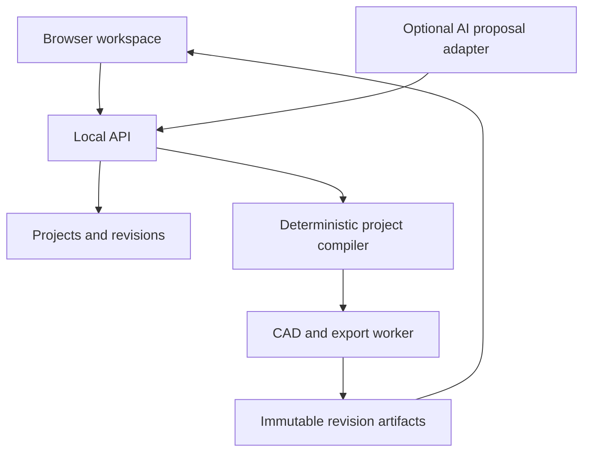

# Woodworking Platform Implementation Plan

**Prepared:** 2026-10-13  
**Audience:** Codex implementing the application and the project owner reviewing its behavior  
**Handoff version:** 1.0  
**Working product name:** Woodworking Planner

## 1. The outcome

Create a woodworking design application in which a person describes a supported furniture project, supplies real dimensions and material thicknesses, reviews a 3D model, and downloads a consistent set of project documents.

The defining capability is reliable change propagation. If a person changes the bookcase width or plywood thickness, the application must update the affected boards, clear openings, 3D assembly, cut list, material quantities, and drawings from the same source. A convincing rendering with contradictory cut dimensions does not meet the product goal.

Begin with a deliberately narrow family: an open-front plywood bookcase with full-height sides, a top and bottom between the sides, zero to four fixed shelves, and a full applied back. Complete that family before adding cabinets with doors, drawers, benches, tables, or workbenches.

The product is software for planning woodworking projects. A person can build the resulting project with appropriate woodworking tools; a 3D printer is not a prerequisite.

## 2. Assumptions and decisions

These are implementation decisions for this handoff, not claims about features already present in text-to-cad.

| Decision | Selected default | Reason |
|---|---|---|
| First user | One person on a Windows computer | Delivers a useful personal tool without an account or hosting project |
| Delivery | Browser UI served by a local Python application | Fits the user's computer while keeping CAD in a suitable runtime |
| Project storage | SQLite plus an application data directory | Simple local persistence with explicit repository interfaces for later migration |
| CAD integration | Pinned cadgen dependency behind our adapter | Reuses the upstream CAD work without coupling every module to it |
| First furniture family | Parametric plywood bookcase | Small enough to verify completely; demonstrates most panel-based workflows |
| Input priority | Structured dimension and material forms | Establishes a reliable core that remains usable without AI |
| Natural language | Optional structured proposal layer | Adds convenience after the same parameters already work through forms |
| Canonical unit | Millimeters represented as normalized decimal strings | Avoids hidden binary rounding and preserves user-entered fractions |
| Initial display | Inches, with metric equivalents in measured outputs | Fits a US workflow while retaining exact material dimensions |
| Initial joinery geometry | Butt-contact panels, no grooves or rabbets | Gives exact, inspectable size rules |
| Construction instructions | Versioned, authored recipe | Fasteners and assembly order require real construction decisions |
| Initial export | CSV, project JSON, STEP, per-part GLB, measured PDF, ZIP | Covers review, building preparation, and future editing |
| CNC | Later DXF profile export only | Toolpaths need a separate machine-specific CAM workflow |
| Hosting, accounts, billing | Deferred | They do not prove that a board has the right dimensions |

Do not ask the project owner to choose among stacks unless the selected stack conflicts with an existing project or a verified runtime constraint. Document routine implementation choices and proceed.

## 3. The first complete user experience

### Create a project

The home screen offers “New bookcase” and a list of saved projects. A small dimension illustration labels outside width, outside height, and outside depth including the applied back. The user selects inches or millimeters and enters dimensions.

The material section separately records the main panel material and back material. A preset may fill a nominal label, but the measured thickness remains explicit and editable. The reference data uses 18 mm main panels and a 6 mm back; a label such as “3/4 in plywood” must never silently change 18 mm to 19.05 mm.

The user selects zero to four fixed shelves. Version 1 uses equal clear openings. The interface immediately explains the derived carcass depth, inside width, number of openings, and number of panels. Final arithmetic is validated by the backend.

### Generate and inspect

“Generate design” creates an immutable project revision and starts a CAD job. While the job runs, the screen shows its actual stage, such as validating parameters, generating geometry, checking dimensions, or preparing outputs.

The viewer supports orbit, pan, zoom, fit, front/side/top/isometric views, select, isolate, hide, and restore. Selecting a board highlights its corresponding instance and cut-list entry. Selecting a cut-list row highlights its member instances. An exploded view is a presentation transform; it never changes stored assembly geometry or exported cut dimensions.

Beside the viewer, show the design dimensions, materials, parts, cut list, construction method, and documents. A successful model does not automatically mark an incomplete construction recipe complete.

### Edit and regenerate

Changing a field makes the current form a draft. Show a compact change summary before applying: for example, “Inside panels become 878.4 mm long; the back becomes 914.4 mm wide.” Applying the change produces a new immutable revision. Keep the previous successful revision available while the new build runs.

Do not silently show an old model under new dimensions. The interface must distinguish “draft inputs,” “building revision,” and “last successful revision.” Downloads always identify their revision.

### Export and reopen

The user can download a project ZIP that contains its canonical specification, resolved parts, CSV cut list, materials and hardware records, drawings, supported geometry files, and artifact manifest. Every file belongs to one revision and has a checksum in the manifest.

The user can close the browser and backend, restart the application, and reopen the same project. The last successful revision remains usable even if an interrupted newer job needs to be retried.

## 4. What the upstream repo contributes

The research baseline is text-to-cad release **v0.7.21**, commit **24573128ceaab564f497d7c12f995c41784c9539**. Recheck compatibility during milestone M0 and keep the initial implementation pinned. The upstream “latest” branch is a plugin distribution branch; it is not the complete development source tree. Use the pinned source when inspecting internals. [Sources U1–U3](docs/SOURCES.md)

| Upstream capability | How this app uses it | Work owned by this application |
|---|---|---|
| Python/build123d geometry and STEP generation | Generate exact panel solids and an assembly | Furniture templates, dimensions, joinery rules, part definitions |
| GLB export | Tessellate unique parts for the browser | Stable instance identity, assembly manifest, selection, scene state |
| Engineering drawing library | Derive measured part views into PDF | Project packet layout, US Letter support, cut-list pages, instructions |
| DXF generation | Later export flat panel profiles | Part profile policy, grain, stock planning, CAM handoff labels |
| Geometry inspection utilities | Check measured dimensions and solid validity | Template-specific tolerances, contact rules, completeness decisions |
| Agent skills and local viewer | Help Codex develop and inspect the adapter | The woodworking product's own UI, storage, job orchestration |

The upstream engineering drawing workflow supports projected, measured PDF views; its documented limits include no section, detail, or auxiliary views. It does not provide a ready-made woodworking instruction system. [U4](docs/SOURCES.md)

The normal static GLB export can merge geometry by color. This app must not assume that a board will survive as a uniquely named GLB node. Version 1 therefore uses per-unique-part GLBs plus application-owned instance transforms and IDs. [U6](docs/SOURCES.md)

## 5. Architecture

### Selected stack

Use React, TypeScript, and Vite for the UI. Use Three.js through React Three Fiber for the model viewer. Use FastAPI and Pydantic in Python 3.13 for the API and domain layer. Use SQLite for local records, with short transactions and one local job dispatcher. Use filesystem artifacts in immutable revision directories.

The CAD runner is a separate operating-system process using the pinned cadgen environment. Long CAD work must not run inside a request handler or be treated as an ordinary FastAPI background callback. The API returns a job ID promptly; the browser polls job status. A broker and distributed queue are unnecessary for the first local release. The process boundary also makes failure recovery and later worker replacement clearer. [T1](docs/SOURCES.md)

For PDFs, use an application-owned report renderer for the multi-page project packet and a separate cadgen engineering-drawing adapter for supported measured part drawings. ReportLab is the selected packet renderer. Confirm the installed public drawing API during M0 rather than inventing a drawing command. If native part sheets remain A4, the application must identify their paper size; it must not relabel or scale them into purported 1:1 Letter templates.

Use standard pytest for domain and worker checks and Playwright for a small set of meaningful browser flows. Use the frontend's normal type checking and build. Pin compatible dependency versions in lockfiles after the integration spike; only cadgen/Python are preselected here.

### Component boundaries

The domain compiler accepts a validated ProjectSpec and returns a ResolvedProject. It has no browser, network, database, or CAD dependency. It calculates parts, quantities, placements, openings, material needs, and construction requirements.

The CAD adapter accepts that resolved project and produces geometry artifacts plus measured verification results. It must not independently reinterpret furniture dimensions.

The export layer receives the resolved project, measured geometry where needed, construction-recipe output, and revision metadata. It never asks AI to invent missing cut dimensions.

The API owns project persistence, immutable revisions, job requests, artifact retrieval, and proposal application. The browser consumes these contracts. The AI adapter can propose validated input changes and explanations; it cannot bypass the domain compiler.

### Application repository

Create a separate application repository. Use these logical boundaries; adapt directory names to a justified existing convention without changing responsibilities.

| Path | Responsibility |
|---|---|
| apps/web | React UI, viewer, typed API client, browser tests |
| services/api/src/woodwork/api | HTTP routes and response contracts |
| services/api/src/woodwork/domain | Models, unit parsing, validation, part ledger, revision hashing |
| services/api/src/woodwork/templates | Versioned trusted furniture templates |
| services/api/src/woodwork/cad_adapter | All direct cadgen/build123d use |
| services/api/src/woodwork/jobs | Dispatcher, process lifecycle, cancellation, recovery |
| services/api/src/woodwork/exports | CSV, PDF, stock layouts, project bundles |
| services/api/src/woodwork/recipes | Versioned construction and hardware recipes |
| services/api/src/woodwork/ai | Provider interface, structured proposals, fake provider |
| services/api/src/woodwork/storage | SQLite repositories, migrations, artifact storage |
| packages/contracts | Generated JSON Schema, OpenAPI client types, shared format fixtures |
| tests/fixtures | Supplied reference projects and expected results |
| scripts | Documented setup, development, preflight, and smoke-test commands |
| docs | Architecture decisions, source provenance, launch guide, implementation status |

Do not import a cadgen private module outside the adapter. Prefer public exports; if an internal interface is unavoidable, pin it, explain it, and add a focused adapter compatibility test.

## 6. Canonical data and units

The supplied JSON Schema is the initial contract. The Python domain models become the maintained implementation source of truth; generated JSON Schema and TypeScript types must remain compatible with it. Do not manually maintain unrelated versions of the same project model in multiple languages.

Store canonical dimensions as normalized decimal millimeter strings, such as “762”, “304.8”, or “18”. Inputs may be decimal millimeters, centimeters, inches, or mixed inch fractions with an explicit unit. Accept denominators 1, 2, 4, 8, 16, 32, and 64. Use the exact international conversion 1 in = 25.4 mm. [T3](docs/SOURCES.md)

Use Decimal/Fraction arithmetic through normalization and the deterministic compiler. Derived repeating positions are resolved once to 0.000001 mm, using round-half-even, when the final ledger is materialized. Convert to floating point only at the geometry/viewer boundary. Display rounding is independent; a rounded inch label never feeds back into the saved design.

Version 1 has separate input, resolved, and artifact records:

- **ProjectSpec:** user intent, template version, dimensions, actual materials, manufacturing settings, construction selection, output preferences.
- **ResolvedProject:** deterministic dimensions, exact/exposed openings, part definitions, physical instances, placements, cut groups, construction requirements, validation results.
- **Revision and ArtifactManifest:** immutable identifiers, source hashes, toolchain versions, job evidence, artifact records, checksums, and completeness state.

Every physical board has a stable logical ID. A side remains “side_left” after a width change. A new or removed shelf is explicitly added or removed. A separate manufacturing fingerprint groups interchangeable cut parts; it must include machining, material, grain, and edge treatment rather than dimensions alone.

For details and matrices, use [DATA-AND-GEOMETRY.md](docs/DATA-AND-GEOMETRY.md). The supplied examples are the authoritative arithmetic baseline.

## 7. Reference bookcase

The reference dimensions are **762 mm wide × 304.8 mm deep × 914.4 mm high**, equivalent to 30 × 12 × 36 inches. The finished outside depth includes the applied back. Main panels are actually 18 mm thick; the back is actually 6 mm thick. There are two fixed shelves, equal clear openings, no edge banding, and no joinery deductions.

| Part category | Quantity | Face-local finished dimensions L × W × T |
|---|---:|---|
| Full-height side | 2 | 914.4 × 298.8 × 18 mm |
| Top, bottom, fixed shelves | 4 | 726 × 298.8 × 18 mm |
| Applied back | 1 | 914.4 × 762 × 6 mm |

The interior width is 726 mm, the carcass depth is 298.8 mm, and each of the three clear openings is 280.8 mm high. The assembly contains seven physical panels. The geometry-only cut list can group them into three rows; adding machining may split groups.

The reference intentionally has no selected fastening recipe. It is a design-engine fixture. A complete build packet requires the recipe contract in section 11.

Required mutations include:

- Width 914.4 mm: inside panels become 878.4 mm long; outside height and panel depth remain fixed.
- Main thickness 19 mm: inside panels become 724 mm long; clear openings become exactly 4192/15 mm before final position quantization.
- Outside depth 355.6 mm: carcass depth becomes 349.6 mm; the back's face dimensions remain tied to height and width.
- Zero shelves: five physical panels, with one 878.4 mm clear opening in the baseline 18 mm material.

These examples test dimensional propagation. They do not establish a furniture load rating.

## 8. Validation behavior

Validation should answer specific questions at the appropriate boundary.

**Input validation** rejects malformed values, unsupported options, duplicate IDs, absent material references, nonpositive dimensions, or impossible openings. Show the affected field, the reason, and a useful correction. Do not silently clamp a design into a different shape.

**Domain validation** checks the template formulas, part counts, material thicknesses, positive blank dimensions, recipe applicability, grain policies, and reference consistency.

**Geometry validation** checks that exported parts exist, are valid solids, have the expected dimensions and placements, and have no unexpected material overlap. The panel template defines permitted face contacts. Contact is not a collision; an inspection failure is not a pass.

**Export validation** checks revision binding, measured dimension agreement, cut-list quantities, readable PDFs, correct units, and file hashes.

**Construction completeness** checks whether the selected recipe supplies the needed operations, compatible hardware, and assembly sequence. Structural capacity remains unassigned unless a separate substantiated method is actually implemented and reviewed.

Keep those results separate. Prefer labels such as “Dimensions checked” and “Construction method needed” to a broad “Safe” or “Certified” label.

## 9. CAD runtime and jobs

Pin cadgen 0.7.21. Upstream examples use managed Python 3.13. Keep runtime setup in an explicit preflight command that reports versions and tests loading the CAD kernel. First-run native/runtime/browser dependencies must be installed before the offline design smoke test. [U1–U3](docs/SOURCES.md)

Version 1 runs only application-owned template code. Job input is immutable JSON data. Reject uploaded Python, evaluated formulas, shell commands, and caller-selected module paths. A subprocess is a lifecycle boundary, not an untrusted-code sandbox.

Disable the upstream warm daemon for the initial worker with CADGEN_DAEMON=0. The app controls one CAD job at a time, an explicit wall-clock deadline, and process-tree cleanup. Give workers app-specific state/cache directories and disable app-worker telemetry without changing the user's separate CAD configuration. [U7](docs/SOURCES.md)

Start with a 120-second CAD job deadline and a 120-second export deadline as adjustable engineering budgets. Log cold/warm timing and peak memory during M0 and M6, then adjust documented budgets using evidence. Do not promise those numbers as achieved performance.

After cancellation or failure, no partial artifact becomes a successful current revision. Use temporary output directories, checksum and validate, publish an immutable artifact set, and then update database pointers transactionally. On restart, expired running jobs become interrupted and can be retried explicitly.

The Windows preflight must diagnose native OCP loading failures. If the documented Windows security/runtime issue applies, offer the supported WSL execution path. Do not automate disabling Windows security. Native Windows and WSL are separate environments; keep each environment's Python, Node, files, and process management coherent. [U1](docs/SOURCES.md)

## 10. Cut lists, material planning, and costs

Derive cut lists from the resolved manufacturing ledger. A row records part or group ID, member instances, material, quantity, finished L/W/T, rough L/W/T where applicable, grain orientation, machining, and edge treatment.

The finished panel dimension is the target board size for the current no-banding/no-rebate template. A rough allowance enlarges a stock blank and is shown separately. Saw kerf is removed by a cut and consumes sheet/board layout space; it is never added to the finished dimensions of every part.

The core release can provide accurate cut lists before it provides a packing algorithm. Add the conservative rectangular stock planner in M4 after the basic documents work. Use actual sheet dimensions, explicit edge trim, measured kerf, material/thickness matching, grain restrictions, and a valid guillotine cut sequence. Describe it as a suggested layout; do not claim optimality.

Area divided by sheet area is only a lower-bound estimate. It cannot establish how many sheets the parts actually fit on. Do not turn that lower bound into a confident shopping quantity.

Material cost estimates use user-entered prices first. Show purchased quantities and consumed material separately. Missing prices remain unknown and make the estimate incomplete; do not treat them as zero. Use decimal money arithmetic, a visible currency, and clearly identified assumptions for waste, consumables, shipping, and tax. Automated retailer prices are deferred.

## 11. Construction method and build instructions

A woodworking platform must explain how boards connect. CAD face contact does not identify a fastener, hole position, jig setting, adhesive requirement, or assembly sequence.

Implement a versioned ConstructionRecipe interface. A supported recipe declares its compatible material and thickness conditions, joint locations, fastener types and quantities, drilling/machining operations, tool requirements, dependency order, and applicable review evidence.

The first implementation should support the baseline butt-contact geometry and a complete authored attachment recipe. A pocket-hole recipe is a reasonable first supported option if its particular jig and actual-thickness rules are sourced from the manufacturer. Kreg's guidance makes actual material thickness and material type relevant to screw selection; it does not justify inventing settings for every possible stock thickness. [W1–W2](docs/SOURCES.md)

Keep the geometry fixture recipe-free. Supply a separate reviewed recipe fixture once the method is implemented. Do not fill missing fastener values with plausible defaults merely to make a shopping list look complete.

The recipe must account for attaching each side/top/bottom/shelf interface and the applied back. A dependency graph determines the order in which parts are machined and assembled. The user-facing instructions identify the affected part IDs and show their orientation. Exploded images support the text; they are not proof that a tool can reach a fastener.

If a recipe is missing or incompatible, allow the model and clearly identified design packet. Mark the missing method beside the relevant instruction/material output. A separate complete build packet is available only when its recipe completeness checks pass.

Before describing a template as physically reviewed for broader public use, record a real build review or other appropriate evidence. Codex can complete the software and produce the review checklist and sample packet; it cannot claim to have performed a physical build that did not occur.

## 12. PDF and project exports

The project packet should include:

1. Cover with project title, revision, outside dimensions, materials, scope, and a 3D overview.
2. Dimensioned assembly views that explain outside dimensions and internal openings.
3. Numbered part list and cut list with consistent IDs and units.
4. Part drawings showing the dimensions and machining actually specified.
5. Material and hardware quantities, with unknown items identified.
6. Authored assembly steps when a complete recipe is selected, otherwise a precise missing-recipe note.
7. Suggested stock layouts only when the layout validator has passed.
8. A compact revision and verification record.

Use Letter as the default for application-owned project pages. Provide A4 as an option. Keep native cadgen ISO part sheets identified by their actual size until the adapter has genuine additional paper support. Readable line weights, text size, whitespace, and nonoverlapping dimension callouts are acceptance requirements.

All PDF values come from the resolved project or measured geometry. Hand-entered dimension strings are prohibited in generated templates. Render and inspect every page for the acceptance examples; the existence of a PDF file is insufficient.

The pinned native drawing code's units string changes the title-block label without converting dimensions. Native part sheets therefore remain explicitly metric in this release; the app's own schedules and summary pages perform real dual-unit conversion. A 25.4 mm feature must read as 1 inch wherever an imperial value is shown. [U9](docs/SOURCES.md)

The ZIP manifest includes each payload file's relative path, MIME type, size, SHA-256, revision ID, and spec hash. It excludes its own checksum and the enclosing ZIP's checksum to avoid a circular definition; those outer hashes belong in the database/export response. Never include API keys, machine-specific absolute paths, raw private prompts, or temp worker files.

Retain whole-assembly STEP and one STEP plus one GLB per unique part definition. The GLBs and manifest provide the interactive scene; a required identity sidecar maps instances to saved assembly occurrences and its file hash. Document jobs publish cumulative artifact sets so adding PDFs never drops the geometry files. STL/3MF are not required for the first woodworking release. Later DXFs are millimeter, 1:1 panel profiles with clearly separated cutting and marking geometry, without router G-code. The repo's G-code workflow is for FDM slicing, so it is not the router toolpath solution. [U5, U8](docs/SOURCES.md)

## 13. Natural-language assistance

Add AI after the validated form workflow and document export work.

Example prompt: “Make a bookcase 30 inches wide, 36 inches high, and 12 inches deep with two fixed shelves. My plywood measures 18 mm and the back is 6 mm.”

The AI adapter returns a structured proposal containing a supported intent, an allowlisted template, proposed field changes, unresolved questions, and a short explanation. It references the base revision. The backend validates its schema and semantics, computes the resulting dimensions, and presents a before/after summary.

The app applies a proposal only through its normal revision-creation service. If the project has changed since the proposal was generated, return a conflict and refresh the proposal. AI text never directly updates the database, part ledger, or files.

Version 1 AI edits may change overall width/height/depth and fixed-shelf count, or ask for missing information. Actual stock thickness is entered through the measured-material form; AI may ask for it but may not silently override a measured value. Requests for unsupported furniture, doors, drawers, organic shapes, or joints produce a specific scope explanation.

Use a provider-neutral interface with a deterministic fake provider. The optional first live adapter can use the user's configured provider, with its model identifier and credentials on the backend only. Codex must consult that provider's current official API documentation during implementation, choose a supported structured-output mechanism, and record the pinned SDK and API behavior. No particular live model or pricing is assumed in this handoff.

Use a configurable request timeout, input and output limits, one schema-repair attempt at most, and no automatic repeat of a request with uncertain billing outcome. The offline form-based workflow must continue to work with AI disabled or unavailable.

## 14. Interface design

The workspace should feel like a useful woodworking tool: a large neutral model viewport, clearly labeled dimensions, a readable parts table, and a small number of strong actions. Use a restrained warm-neutral palette with clear selected-part color. Avoid a marketing landing page as the main application.

On a desktop screen, use a left parameter panel, center viewport, and right details panel that can collapse. Put parts/documents/materials in tabs below or beside the viewport. On narrower screens, stack the parameter and detail panels; keep tables scrollable without losing headings.

Support keyboard navigation, visible focus, labeled form inputs, text alternatives for validation status, and selection that is not communicated by color alone. A person should be able to enter parameters and download a cut list without operating the 3D viewport.

Essential screen states include no projects, initial runtime setup, editing, validation error, queued job, active job, cancellation, failed job, successful revision, changed draft, missing construction method, missing optional AI configuration, and offline AI failure. Design those states as part of the product.

## 15. Local data and operating behavior

Bind the API to loopback only. Serve the built UI from the same application origin for ordinary use; use a narrowly allowed development origin while Vite runs separately. Check Host and Origin, protect state-changing local requests against cross-origin use, and never allow a caller to select an arbitrary filesystem path.

Place application data outside the code checkout under an explicit configurable data root. SQLite records metadata; artifact paths are server-generated relative paths underneath that root. Do not place a live SQLite file in a cloud-synced folder by default. Provide project ZIP export/import for portable backups.

Keep imports inert: validate JSON, size limits, schema versions, file hashes, relative paths, and ZIP entry paths; do not execute model source received in a project package. Rebuild supported projects from the canonical specification with installed trusted templates.

Keep optional API keys on the backend in environment/local settings excluded from git. Logs should contain useful stage/error codes, runtime versions, and timings without keys or full private prompts. Application-worker telemetry is off by default.

A later hosted version adds authenticated ownership, tenant isolation, remote object storage, a proper durable queue, rate limits, usage accounting, backup/restore, and restricted worker execution. Those are separate release requirements. Opening a local port to the internet is not the hosted architecture.

## 16. Implementation sequence and definition of done

Follow [IMPLEMENTATION-SEQUENCE.md](docs/IMPLEMENTATION-SEQUENCE.md). The major gates are:

| Milestone | Result that must be demonstrable |
|---|---|
| M0 — Integration spike | Pinned runtime builds a trusted part and exports it with verified units, orientation, and identity strategy |
| M1 — Deterministic engine | Baseline and mutation fixtures yield correct parts, solids, CSV, and manifest without AI or browser |
| M2 — Local application | Create, edit, inspect, select, save, reopen, cancel, and recover a real project |
| M3 — Measured documents | PDF packet and construction-recipe contract work; incomplete and complete recipe cases are distinguished |
| M4 — Stock and costing | Conservative verified layouts and transparent material estimates use real quantities and explicit prices |
| M5 — AI proposals | Structured natural-language edits use the same validated engine and handle missing data/conflicts |
| M6 — Local release | Setup, failure recovery, meaningful tests, sample projects, documentation, and export/import are complete |

M0–M3 are the first useful product. M4–M6 complete the planned local version. Additional furniture families and public hosting remain later work.

An acceptance test is complete only when it ran and its result is recorded. The supplied acceptance document describes tests for Codex to implement; this handoff does not claim those application tests have already run.

## 17. Performance and cost discipline

Collect timing evidence during the first CAD spike, then use it to set realistic user-facing expectations. Provisional targets are sub-second pure parameter compilation, responsive status polling during CAD work, a usable viewer for the reference seven-panel project, and bounded background job duration. These are design budgets, not measured claims.

Do not add paid infrastructure to get through M0–M3. The form workflow needs no inference service. Optional AI usage has provider costs determined by the chosen model, tokens, images, and request volume; add usage visibility when a live adapter exists. Hosting and retailer-price integrations are future budget decisions.

Do not quote a fixed completion date based on this plan alone. After M0 and M1, report the actual integration difficulties, elapsed engineering work, and remaining milestone scope. That is the point at which a useful schedule estimate can be made.

## 18. Later product roadmap

Add one capability at a time, with new fixtures and construction rules.

1. **More panel furniture:** a wall-free storage cabinet, console, or media cabinet, each with explicit supported constraints.
2. **Adjustable shelves:** shelf-pin system, hole patterns, setbacks, hardware, and drilling templates.
3. **Doors and drawers:** reveal/inset/overlay rules, specific hinge and slide models, interference and opening checks.
4. **More joinery:** dados, rabbets, dowels, edge banding, and tool-aware recipes with changed cut-size semantics.
5. **Solid wood:** actual board sizes, grain and movement allowances, rough milling, and material-specific joints.
6. **Reference images:** style and proportions with user-supplied dimensional anchors; never infer hidden measurements as facts.
7. **CNC preparation:** verified DXF profiles and a separately specified CAM integration.
8. **Hosted platform:** accounts, saved cloud projects, sharing, templates, billing, and operational support after local trust is established.

Do not label a renamed bookcase template as a storage bench or load-bearing work platform without supplying the new construction assumptions and review. Those uses change the design problem.

## 19. Acceptance demonstration

The final local demonstration must show a new project generated from the reference fixture; seven selectable panels and correct cut groups; readable measured drawings; a width change to 36 inches; a material change to 19 mm; a zero-shelf project; a rejected impossible design; a cancelled job; recovery after restart; and a consistent exported ZIP that can be reopened.

Demonstrate a missing recipe producing a design packet and a complete supported recipe producing its corresponding instructions. Demonstrate the fake AI provider and, if configured, the live provider. Show that the app remains usable with AI disabled.

Report concrete evidence and remaining limitations. A successful software demonstration does not stand in for a physical construction review.

## 20. Source and decision boundaries

Primary source links, pinned upstream files, and the exact scope of each source are in [SOURCES.md](docs/SOURCES.md). Source-backed facts describe available tools and documented formats. The architecture, template equations, product limits, schema, milestones, and acceptance gates are the proposed engineering specification.

If runtime behavior contradicts a source or this handoff, reproduce the difference with the smallest example, record it in an architecture decision, update the adapter and affected fixture deliberately, and rerun the relevant checks. Do not silently weaken dimensional consistency or completeness requirements to make a milestone pass.
